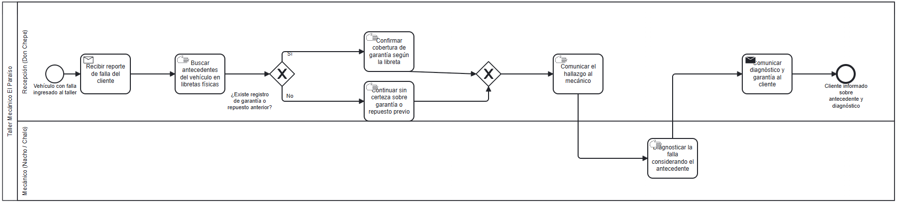
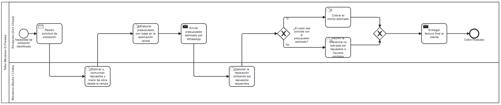
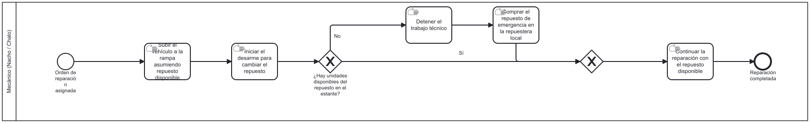
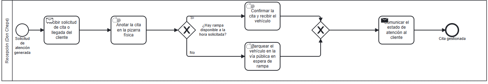
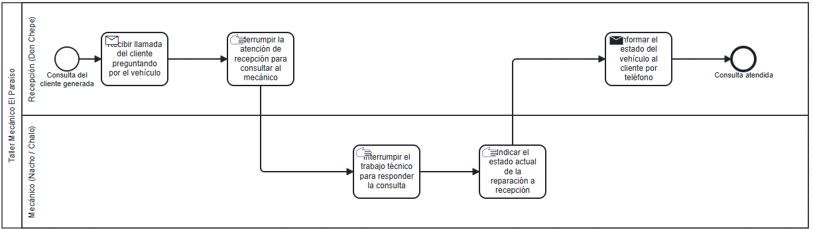

# Trazabilidad: Proceso BPMN → Requerimiento Funcional

| Requerimiento Funcional | Elemento del Diagrama BPMN (proceso / actividad / compuerta) | Problema que atiende |
| :--- | :--- | :--- |
| **[RF-01](../../02-requerimientos/funcionales/RF-01-consulta-historial-vehicular.md)** | Diagrama [`RF-01-consulta-historial-vehicular.bpmn`](RF-01-consulta-historial-vehicular.bpmn)  — Tarea manual: *"Buscar antecedentes del vehículo en libretas físicas"* — Compuerta: *"¿Existe registro de garantía o repuesto anterior?"* | **Pérdida de historial vehicular:** No hay registro digital de servicios pasados, hay que depender de la memoria del mecánico o de libretas viejas. |
| **[RF-02](../../02-requerimientos/funcionales/RF-02-cotizacion-y-cobro.md)** | Diagrama [`RF-02-cotizacion-y-cobro.bpmn`](RF-02-cotizacion-y-cobro.bpmn)  — Tarea manual: *"Estimar y comunicar repuestos y mano de obra desde la rampa"* — Compuerta: *"¿El costo real coincide con el presupuesto estimado?"* (rama "No" → *"Asumir la diferencia no cobrada por repuestos o líquidos omitidos"*) | **Presupuestos y cobros desorganizados:** Cotización informal por WhatsApp que deriva en discrepancias al cobrar u omisión de cobro de mano de obra o insumos. |
| **[RF-03](../../02-requerimientos/funcionales/RF-03-catalogo-insumos.md)** | Diagrama [`RF-03-verificacion-uso-repuestos.bpmn`](RF-03-verificacion-uso-repuestos.bpmn)  — Compuerta: *"¿Hay unidades disponibles del repuesto en el estante?"* (rama "No" → *"Detener el trabajo técnico"* / *"Comprar el repuesto de emergencia en la repuestera local"*) | **Control de repuestos informal:** Compras sobre la marcha sin inventario claro, resultando en repuestos agotados a medio trabajo. |
| **[RF-04](../../02-requerimientos/funcionales/RF-04-planificador-rampas.md)** | Diagrama [`RF-04-agendamiento-citas-rampas.bpmn`](RF-04-agendamiento-citas-rampas.bpmn)  — Tarea manual: *"Anotar la cita en la pizarra física"* — Compuerta: *"¿Hay rampa disponible a la hora solicitada?"* (rama "No" → *"Parquear el vehículo en la vía pública en espera de rampa"*) | **Desfase en agenda y espacio físico:** Asignación ineficiente de rampas y cuellos de botella que bloquean la entrada de nuevos vehículos. |
| **[RF-05](../../02-requerimientos/funcionales/RF-05-tablero-control-flujo.md)** | Diagrama [`RF-05-consulta-estado-vehiculo.bpmn`](RF-05-consulta-estado-vehiculo.bpmn)  — Tareas manuales: *"Interrumpir la atención de recepción para consultar al mecánico"* e *"Interrumpir el trabajo técnico para responder la consulta"* | **Comunicación caótica e interrupciones:** Llamadas constantes de clientes que obligan a interrumpir el trabajo técnico para consultar el estado del vehículo. |