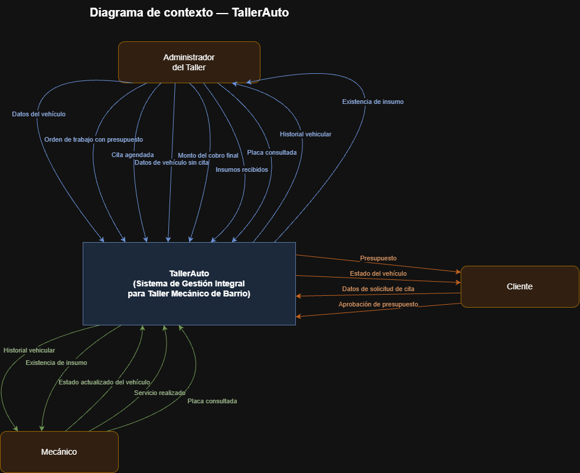

# Diagrama de contexto

Muestra TallerAuto como un único proceso (caja negra) frente a las entidades externas con las que intercambia información. No describe el interior del sistema: ningún módulo, pantalla ni tabla aparece aquí, solo los actores y los datos que cruzan la frontera del sistema.

**Fuente editable:** [`diagrama-de-contexto.drawio`](diagrama-de-contexto.drawio) (ábrelo en [app.diagrams.net](https://app.diagrams.net) o en la extensión de draw.io para VS Code).

## Entidades externas

Las tres entidades corresponden a los actores ya definidos en [`docs/03-casos-de-uso/actores.md`](../03-casos-de-uso/actores.md): **Administrador del Taller**, **Mecánico** y **Cliente**. Ninguna entidad nueva se introduce en este diagrama.

## Descripción de los flujos

| Origen | Destino | Dato | Caso de uso |
|---|---|---|---|
| Administrador del Taller | TallerAuto | Datos del vehículo | [CU-06](../03-casos-de-uso/CU-06-registrar-vehiculo.md) |
| Administrador del Taller | TallerAuto | Orden de trabajo con presupuesto | [CU-02](../03-casos-de-uso/CU-02-registrar-orden-con-presupuesto.md) |
| Administrador del Taller | TallerAuto | Cita agendada | [CU-04](../03-casos-de-uso/CU-04-agendar-cita-de-mantenimiento.md) |
| Administrador del Taller | TallerAuto | Datos de vehículo sin cita | [CU-07](../03-casos-de-uso/CU-07-registrar-llegada-sin-cita.md) |
| Administrador del Taller | TallerAuto | Monto del cobro final | [CU-12](../03-casos-de-uso/CU-12-registrar-cobro-final.md) |
| Administrador del Taller | TallerAuto | Insumos recibidos | [CU-13](../03-casos-de-uso/CU-13-registrar-ingreso-de-insumos.md) |
| Administrador del Taller | TallerAuto | Placa consultada | [CU-01](../03-casos-de-uso/CU-01-consultar-historial-vehicular.md) |
| TallerAuto | Administrador del Taller | Historial vehicular | [CU-01](../03-casos-de-uso/CU-01-consultar-historial-vehicular.md) |
| TallerAuto | Administrador del Taller | Existencia de insumo | [CU-08](../03-casos-de-uso/CU-08-consultar-existencia-de-insumo.md) |
| Mecánico | TallerAuto | Estado actualizado del vehículo | [CU-05](../03-casos-de-uso/CU-05-actualizar-estado-de-vehiculo.md) |
| Mecánico | TallerAuto | Servicio realizado | [CU-11](../03-casos-de-uso/CU-11-registrar-servicio-y-cerrar-orden.md) |
| Mecánico | TallerAuto | Placa consultada | [CU-01](../03-casos-de-uso/CU-01-consultar-historial-vehicular.md) |
| TallerAuto | Mecánico | Historial vehicular | [CU-01](../03-casos-de-uso/CU-01-consultar-historial-vehicular.md) |
| TallerAuto | Mecánico | Existencia de insumo | [CU-08](../03-casos-de-uso/CU-08-consultar-existencia-de-insumo.md) |
| Cliente | TallerAuto | Datos de solicitud de cita | [CU-04](../03-casos-de-uso/CU-04-agendar-cita-de-mantenimiento.md), [CU-07](../03-casos-de-uso/CU-07-registrar-llegada-sin-cita.md) |
| Cliente | TallerAuto | Aprobación de presupuesto | [CU-10](../03-casos-de-uso/CU-10-registrar-aprobacion-de-presupuesto.md) |
| TallerAuto | Cliente | Presupuesto | [CU-02](../03-casos-de-uso/CU-02-registrar-orden-con-presupuesto.md) |
| TallerAuto | Cliente | Estado del vehículo | [CU-09](../03-casos-de-uso/CU-09-consultar-estado-de-vehiculo.md) |

---

**Documento preparado por:** Jared Morales Morales S
