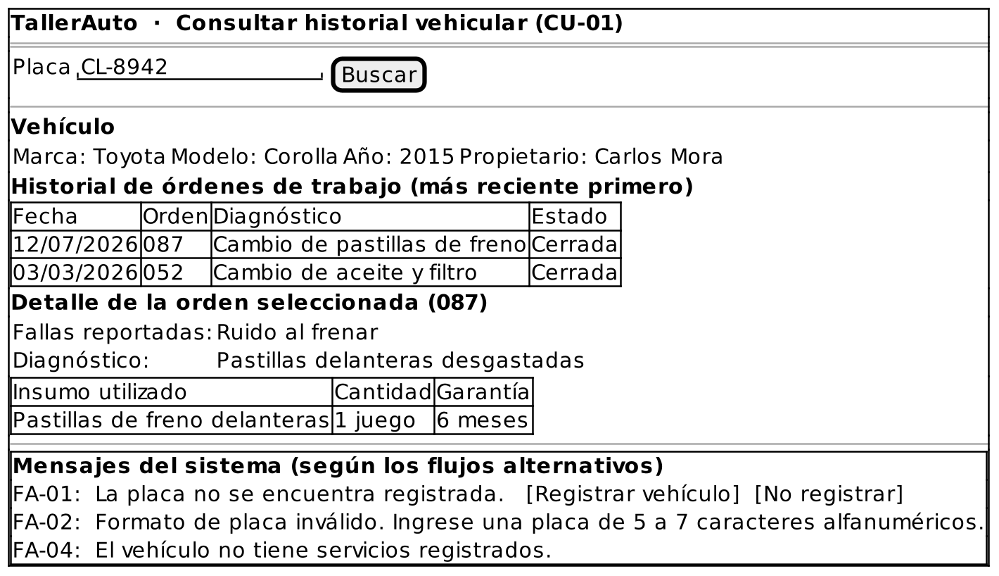

# Caso de Uso: CU-01 — Consultar Historial Vehicular por Placa

### Código
`CU-01`

### Issue
[CU-01 en GitHub](https://github.com/IF-6100-2026/TallerAuto-docs/issues/7)

### Requerimiento funcional que atiende
[RF-01 — Consulta del historial de servicio por placa](../02-requerimientos/funcionales/RF-01-consulta-historial-vehicular.md)

### Descripción
Busca el expediente de un vehículo a partir de su placa y despliega sus reparaciones previas, diagnósticos, insumos utilizados con su garantía y fechas de atención. Atiende al requerimiento **RF-01**.

### Actores
- **Primarios**: Administrador del Taller, Mecánico
- **Secundarios**: Cliente

### Precondiciones
Ninguna.

### Postcondiciones
- **Éxito**: El sistema despliega la información general del vehículo y su historial cronológico de órdenes de trabajo.
- **Falla**: El sistema no despliega historial. Cuando la placa no está registrada, ofrece registrar el vehículo (CU-06).

### Flujo Principal
1. El Administrador o el Mecánico solicita buscar un vehículo por placa.
2. El Administrador o el Mecánico ingresa el número de placa.
3. El sistema valida el formato de la placa.
4. El sistema busca el vehículo asociado a la placa.
5. El sistema despliega la información general del vehículo (marca, modelo, año y propietario) y la lista cronológica de sus órdenes de trabajo anteriores.
6. El Administrador o el Mecánico selecciona una orden de trabajo.
7. El sistema despliega el detalle de la orden: fallas, diagnóstico e insumos utilizados con su garantía.

### Flujos Alternativos

#### FA-01: Vehículo no registrado
1. En el paso 4 del flujo principal, el sistema determina que no existe un vehículo asociado a la placa ingresada.
2. El sistema informa "La placa no se encuentra registrada." y ofrece registrar el vehículo.
3. El Administrador o el Mecánico acepta registrar el vehículo.
4. El sistema ejecuta CU-06 Registrar Vehículo con la placa ingresada (`<<extend>>`, punto de extensión: "placa no registrada").
5. Al finalizar CU-06, el flujo regresa al paso 4 del flujo principal.

#### FA-02: Formato de placa inválido
1. En el paso 3 del flujo principal, el sistema determina que la placa tiene un formato incorrecto.
2. El sistema informa "Formato de placa inválido. Ingrese una placa de 5 a 7 caracteres alfanuméricos."
3. El flujo regresa al paso 2 del flujo principal.

#### FA-03: Registro de vehículo declinado
1. En el paso 3 del FA-01, el Administrador o el Mecánico indica que no desea registrar el vehículo.
2. El caso de uso termina sin cambios.

#### FA-04: Vehículo sin servicios previos
1. En el paso 5 del flujo principal, el sistema determina que el vehículo está registrado pero no tiene órdenes de trabajo.
2. El sistema despliega la información general del vehículo e informa "El vehículo no tiene servicios registrados."
3. El caso de uso termina.

### Prototipos

Prototipo editable: [`CU-01.puml`](prototipos/CU-01.puml). Los mensajes que muestra el prototipo son los de los flujos alternativos de este caso de uso.

### Requerimientos Especiales
- La consulta debe responder en menos de 5 segundos (RS-02).

### Escenarios de Prueba

Guion Gherkin ejecutable: [`pruebas/CU-01.feature`](../04-pruebas/CU-01.feature)

| Entrada | Salida Esperada |
|---------|-----------------|
| **E1 · Flujo principal.** Un mecánico ingresa la placa registrada "CL-8942" y luego selecciona una orden del historial. | El sistema despliega la ficha del vehículo y su historial cronológico en menos de 5 segundos, y luego el detalle de la orden (fallas, diagnóstico e insumos con garantía). |
| **E2 · FA-01.** Un administrador ingresa la placa no registrada "XYZ-999" y acepta registrar el vehículo. | El sistema informa "La placa no se encuentra registrada.", ejecuta CU-06 y, al terminar, repite la búsqueda. |
| **E3 · FA-02.** Un mecánico ingresa la placa "12". | El sistema informa "Formato de placa inválido. Ingrese una placa de 5 a 7 caracteres alfanuméricos." y solicita la placa de nuevo. |
| **E4 · FA-03.** Con la placa no registrada "XYZ-999", el usuario indica que no desea registrar el vehículo. | El caso de uso termina y no se crea ningún registro. |
| **E5 · FA-04.** Un administrador ingresa la placa "ABC-123", registrada y sin órdenes de trabajo. | El sistema despliega la información general e informa "El vehículo no tiene servicios registrados." |

---

**Documento Preparado Por:** José A Ramírez  
**Fecha:** 19/09/2026
