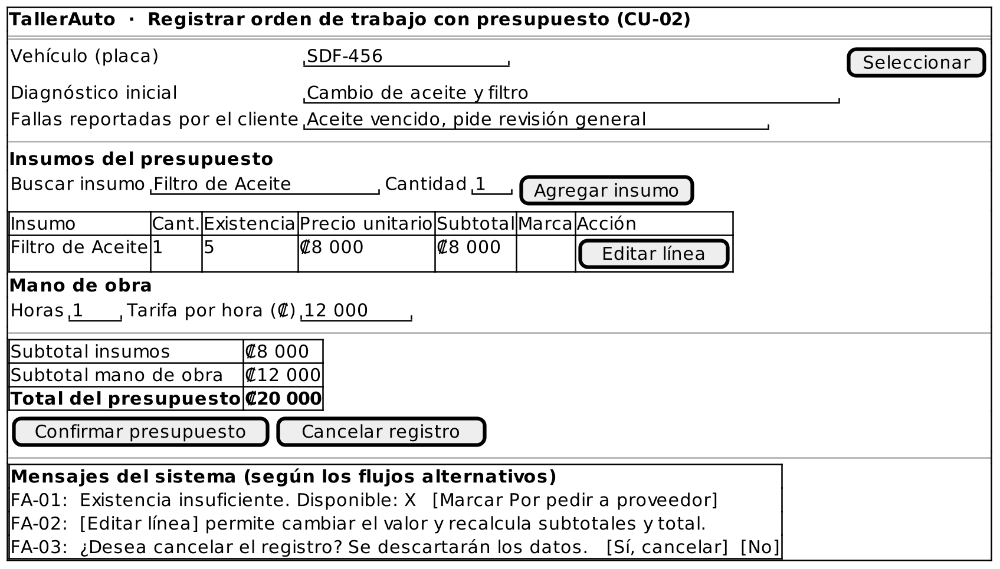

# Caso de Uso: CU-02 — Registrar Orden de Trabajo con Presupuesto

### Código
`CU-02`

### Issue
[CU-02 en GitHub](https://github.com/IF-6100-2026/TallerAuto-docs/issues/8)

### Requerimiento funcional que atiende
[RF-02 — Elaboración de presupuestos desglosados](../02-requerimientos/funcionales/RF-02-cotizacion-y-cobro.md)

### Descripción
Registra el diagnóstico inicial de un vehículo, los insumos requeridos y las horas de mano de obra, y genera el presupuesto desglosado en una orden de trabajo. Atiende al requerimiento **RF-02**.

### Actores
- **Primarios**: Administrador del Taller, Mecánico
- **Secundarios**: Cliente (reporta las fallas del vehículo)

### Precondiciones
El vehículo está registrado en el sistema.

### Postcondiciones
- **Éxito**: Queda registrada una orden de trabajo con su diagnóstico y su presupuesto, en estado "Esperando Aprobación". Los insumos del presupuesto no descuentan existencias, y el estado del vehículo no se modifica (se actualiza mediante CU-05).
- **Falla / Cancelación**: No se registra ninguna orden de trabajo y los datos ingresados se descartan.

### Flujo Principal
1. El Administrador o el Mecánico selecciona el vehículo y solicita crear una orden de trabajo.
2. El Administrador o el Mecánico registra el diagnóstico inicial y las fallas reportadas por el cliente.
3. El Administrador o el Mecánico busca un insumo del catálogo e indica la cantidad requerida.
4. El sistema ejecuta CU-08 Consultar Existencia de Insumo (`<<include>>`) y agrega el insumo al presupuesto con su precio unitario.
5. El Administrador o el Mecánico repite los pasos 3 y 4 hasta completar los insumos requeridos.
6. El Administrador o el Mecánico registra las horas de mano de obra y la tarifa aplicable.
7. El sistema calcula los subtotales de insumos y de mano de obra, y el total del presupuesto.
8. El Administrador confirma el presupuesto. Si quien tiene la sesión abierta es el Mecánico, el sistema no permite este paso (ver FA-05).
9. El sistema registra la orden de trabajo con su presupuesto en estado "Esperando Aprobación".

### Flujos Alternativos

#### FA-01: Existencia insuficiente de un insumo
1. En el paso 4 del flujo principal, el sistema determina que la cantidad requerida supera la existencia del insumo (incluida una existencia de cero).
2. El sistema informa "Existencia insuficiente. Disponible: X".
3. El Administrador o el Mecánico marca el insumo como "Por pedir a proveedor".
4. El sistema agrega el insumo al presupuesto con la marca "Por pedir a proveedor", sin descontar existencias.
5. El flujo regresa al paso 5 del flujo principal.

#### FA-02: Ajuste manual de una línea del presupuesto
1. En el paso 8 del flujo principal, el Administrador solicita modificar el valor de una línea del presupuesto.
2. El Administrador ingresa el nuevo valor.
3. El sistema recalcula los subtotales y el total.
4. El flujo regresa al paso 8 del flujo principal.

#### FA-03: Cancelación del registro
1. En cualquier momento previo al paso 8 del flujo principal, el Administrador o el Mecánico solicita cancelar el registro.
2. El sistema solicita confirmar la cancelación.
3. El Administrador o el Mecánico confirma la cancelación.
4. El sistema descarta los datos ingresados y regresa al expediente del vehículo. El caso de uso termina.

#### FA-04: Cancelación no confirmada
1. En el paso 3 del FA-03, el Administrador o el Mecánico no confirma la cancelación.
2. El sistema conserva los datos ingresados y el flujo regresa al paso en que se solicitó cancelar.

#### FA-05: Confirmación no autorizada por rol
1. En el paso 8 del flujo principal, el usuario con la sesión abierta tiene el rol Mecánico.
2. El sistema deniega la confirmación e informa "Solo el rol Administrador puede confirmar el presupuesto."
3. El flujo regresa al paso 6 del flujo principal; el diagnóstico y los insumos ya registrados se conservan hasta que un usuario con rol Administrador confirme el presupuesto.

### Prototipos

Prototipo editable: [`CU-02.puml`](prototipos/CU-02.puml). Los mensajes que muestra el prototipo son los de los flujos alternativos de este caso de uso.

### Requerimientos Especiales
- La confirmación del presupuesto (paso 8) y el ajuste manual de sus valores (FA-02) requieren el rol Administrador; el rol Mecánico puede registrar el diagnóstico y los insumos, pero no confirmar ni modificar el presupuesto (RS-01).
- Un operador sin experiencia previa debe completar el registro de la orden y la generación del presupuesto sin ayuda, tras 15 minutos de explicación (RS-03).

### Escenarios de Prueba

Guion Gherkin ejecutable: [`pruebas/CU-02.feature`](../04-pruebas/CU-02.feature)

| Entrada | Salida Esperada |
|---------|-----------------|
| **E1 · Flujo principal.** Vehículo "SDF-456", diagnóstico "Cambio de aceite y filtro", 1 filtro de ₡8 000 (existencia 5) y 1 hora de mano de obra a ₡12 000; un Administrador confirma el presupuesto. | El sistema calcula un total de ₡20 000 y registra la orden en estado "Esperando Aprobación". La existencia del filtro sigue en 5. |
| **E2 · FA-01, existencia cero.** El usuario agrega 1 unidad de "Bomba de Agua" con existencia 0 y la marca "Por pedir a proveedor". | El sistema informa "Existencia insuficiente. Disponible: 0", agrega la bomba al presupuesto con la marca "Por pedir a proveedor" y la existencia sigue en 0. |
| **E3 · FA-01, existencia parcial.** El usuario agrega 4 unidades de "Bujía" con existencia 2 y las marca "Por pedir a proveedor". | El sistema informa "Existencia insuficiente. Disponible: 2", agrega las 4 bujías con la marca y la existencia sigue en 2. |
| **E4 · FA-02.** Con el presupuesto de E1, un Administrador cambia el precio del filtro a ₡7 500. | El sistema recalcula el total en ₡19 500 y solicita confirmar el presupuesto. |
| **E5 · FA-03.** Tras ingresar un diagnóstico preliminar, el usuario cancela y confirma la cancelación. | El sistema descarta los datos, no registra ninguna orden y regresa al expediente del vehículo. |
| **E6 · FA-04.** Tras ingresar un diagnóstico preliminar, el usuario cancela y no confirma. | El sistema conserva el diagnóstico y el usuario continúa donde estaba. |
| **E7 · RS-03.** Un operador sin experiencia, con 15 minutos de explicación, registra una orden con presupuesto sin ayuda. | El operador completa el registro sin asistencia. |
| **E8 · FA-05, restricción de rol.** Con el diagnóstico e insumos de E1 registrados, un usuario con rol Mecánico intenta confirmar el presupuesto en el paso 8. | El sistema informa "Solo el rol Administrador puede confirmar el presupuesto.", no registra la orden y conserva el diagnóstico y los insumos ingresados. |

---

**Documento Preparado Por:** José A Ramírez  
**Fecha:** 19/09/2026
