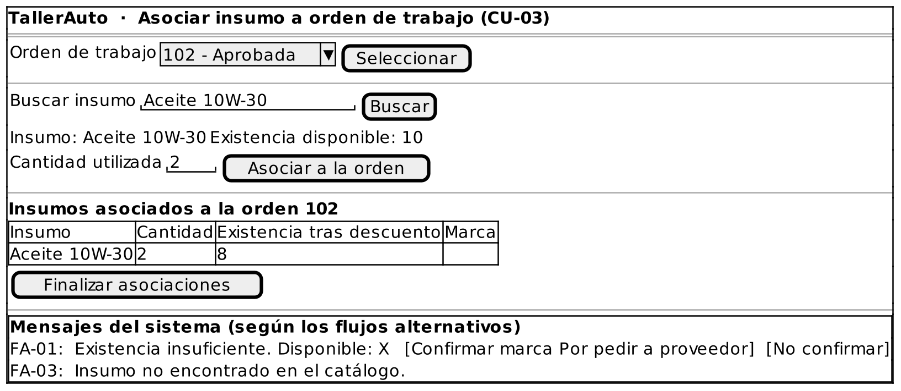

# Caso de Uso: CU-03 — Asociar Insumo a Orden de Trabajo

### Código
`CU-03`

### Issue
[CU-03 en GitHub](https://github.com/IF-6100-2026/TallerAuto-docs/issues/9)

### Requerimiento funcional que atiende
[RF-03 — Catálogo de insumos y control de existencias](../02-requerimientos/funcionales/RF-03-catalogo-insumos.md)

### Descripción
Asocia a una orden de trabajo los insumos efectivamente utilizados y descuenta su cantidad de las existencias. Atiende al requerimiento **RF-03**.

### Actores
- **Primarios**: Administrador del Taller
- **Secundarios**: Mecánico (informa los insumos utilizados)

### Precondiciones
Existe una orden de trabajo en estado "Aprobada".

### Postcondiciones
- **Éxito**: Cada insumo queda asociado a la orden con su cantidad. Si había existencia suficiente, esta se reduce en esa cantidad. Si no, el insumo queda marcado "Por pedir a proveedor" y la existencia no cambia. La existencia nunca queda negativa.
- **Falla**: No se asocia ningún insumo y las existencias no cambian.

### Flujo Principal
1. El administrador solicita asociar un insumo a una orden de trabajo.
2. El administrador selecciona la orden de trabajo.
3. El administrador busca el insumo utilizado.
4. El sistema ejecuta CU-08 Consultar Existencia de Insumo (`<<include>>`) y despliega la existencia disponible.
5. El administrador indica la cantidad utilizada.
6. El sistema verifica que la cantidad no supere la existencia.
7. El sistema descuenta la cantidad de las existencias.
8. El sistema registra el insumo y su cantidad en la orden de trabajo.
9. El administrador repite los pasos 3 a 8 hasta asociar todos los insumos utilizados.
10. El sistema confirma las asociaciones registradas.

### Flujos Alternativos

#### FA-01: Existencia insuficiente
1. En el paso 6 del flujo principal, el sistema determina que la cantidad supera la existencia (incluida una existencia de cero).
2. El sistema informa "Existencia insuficiente. Disponible: X" y propone marcar el insumo como "Por pedir a proveedor".
3. El administrador confirma la marca.
4. El sistema registra el insumo y su cantidad en la orden con la marca "Por pedir a proveedor", sin descontar existencias.
5. El flujo regresa al paso 9 del flujo principal.

#### FA-02: Marca "Por pedir" rechazada
1. En el paso 3 del FA-01, el administrador no confirma la marca.
2. El sistema no registra el insumo y el flujo regresa al paso 5 del flujo principal para ajustar la cantidad.

#### FA-03: Insumo no encontrado
1. En el paso 4 del flujo principal, el sistema determina que el insumo buscado no existe en el catálogo.
2. El sistema informa "Insumo no encontrado en el catálogo."
3. El flujo regresa al paso 3 del flujo principal.

### Prototipos

Prototipo editable: [`CU-03.puml`](prototipos/CU-03.puml). Los mensajes que muestra el prototipo son los de los flujos alternativos de este caso de uso.

### Requerimientos Especiales
Ninguno.

### Escenarios de Prueba

Guion Gherkin ejecutable: [`pruebas/CU-03.feature`](../04-pruebas/CU-03.feature)

| Entrada | Salida Esperada |
|---------|-----------------|
| **E1 · Flujo principal.** Orden #102 "Aprobada". Se asocian 2 unidades de "Aceite 10W-30" (existencia 10). | El sistema descuenta 2 unidades, la existencia queda en 8 y el insumo queda asociado a la orden. |
| **E2 · Flujo principal con repetición.** Orden #102. Se asocian 2 unidades de "Aceite 10W-30" (existencia 10) y luego 1 "Filtro de Aceite" (existencia 6). | Las existencias quedan en 8 y en 5, y ambos insumos quedan asociados a la orden. |
| **E3 · FA-01, existencia cero.** Se asocia 1 "Filtro de Aire" (existencia 0) y el administrador confirma la marca. | El sistema informa "Existencia insuficiente. Disponible: 0", asocia el filtro con la marca "Por pedir a proveedor" y la existencia sigue en 0. |
| **E4 · FA-01, existencia parcial.** Se asocian 5 unidades de "Aceite 10W-30" (existencia 3) y el administrador confirma la marca. | El sistema asocia las 5 unidades con la marca "Por pedir a proveedor" y la existencia sigue en 3. |
| **E5 · FA-02.** Mismo caso que E4, pero el administrador no confirma la marca. | El sistema no asocia el insumo, la existencia sigue en 3 y solicita indicar la cantidad de nuevo. |
| **E6 · FA-03.** El administrador busca el insumo "Bujía-ZZZ", que no existe. | El sistema informa "Insumo no encontrado en el catálogo." y solicita buscar de nuevo. |

---

**Documento Preparado Por:** José A Ramírez  
**Fecha:** 19/09/2026
