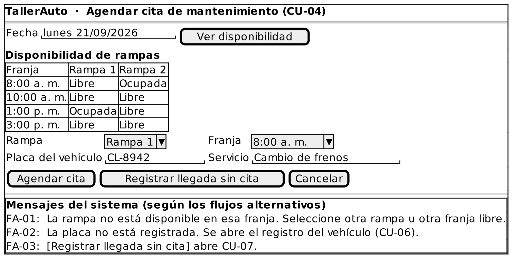

# Caso de Uso: CU-04 — Agendar Cita de Mantenimiento

### Código
`CU-04`

### Issue
[CU-04 en GitHub](https://github.com/IF-6100-2026/TallerAuto-docs/issues/10)

### Requerimiento funcional que atiende
[RF-04 — Planificador de citas y asignación de rampas](../02-requerimientos/funcionales/RF-04-planificador-rampas.md)

### Descripción
Programa citas de servicio sobre una agenda por rampa física y franja horaria. Atiende al requerimiento **RF-04**.

### Actores
- **Primarios**: Administrador del Taller
- **Secundarios**: Cliente

### Precondiciones
Las rampas y el horario del taller están configurados.

### Postcondiciones
- **Éxito**: La cita queda asignada a un vehículo, una rampa y una franja horaria libres, y la rampa queda bloqueada en esa franja.
- **Falla**: No se crea la cita y la agenda no cambia. El sistema no permite dos citas en la misma rampa y franja.

### Flujo Principal
1. El administrador solicita agendar una cita.
2. El administrador selecciona la fecha.
3. El sistema despliega la disponibilidad de las rampas por franja horaria para esa fecha.
4. El administrador selecciona una rampa y una franja horaria.
5. El sistema verifica que la rampa esté libre en esa franja.
6. El administrador indica la placa del vehículo y el servicio a realizar.
7. El sistema registra la cita asociada al vehículo, la rampa y la franja.
8. El sistema bloquea la rampa para esa franja y confirma la cita.

### Flujos Alternativos

#### FA-01: Conflicto de horario en la misma rampa
1. En el paso 5 del flujo principal, el sistema determina que la rampa y la franja seleccionadas ya están asignadas a otra cita.
2. El sistema notifica el conflicto y sugiere seleccionar otra rampa u otra franja libre.
3. El flujo regresa al paso 4 del flujo principal.

#### FA-02: Vehículo no registrado
1. En el paso 6 del flujo principal, el sistema determina que la placa indicada no está registrada.
2. El sistema ejecuta CU-06 Registrar Vehículo (`<<extend>>`, punto de extensión: "placa no registrada").
3. Al finalizar CU-06, el flujo regresa al paso 6 del flujo principal.

#### FA-03: Cliente que llega sin cita previa
1. En el paso 1 del flujo principal, el cliente llega al taller sin haber reservado.
2. El administrador solicita registrar la llegada sin cita.
3. El sistema ejecuta CU-07 Registrar Llegada de Vehículo sin Cita (`<<extend>>`, punto de extensión: "cliente sin cita"). El caso de uso termina.

### Prototipos

Prototipo editable: [`CU-04.puml`](prototipos/CU-04.puml). Los mensajes que muestra el prototipo son los de los flujos alternativos de este caso de uso.

### Requerimientos Especiales
- Un operador sin experiencia previa debe completar el agendamiento sin ayuda, tras 15 minutos de explicación (RS-03).

### Escenarios de Prueba

Guion Gherkin ejecutable: [`pruebas/CU-04.feature`](../04-pruebas/CU-04.feature)

| Entrada | Salida Esperada |
|---------|-----------------|
| **E1 · Flujo principal.** El lunes a las 8:00 a. m., Rampa 1 libre, vehículo "CL-8942", servicio "Cambio de frenos". | El sistema registra la cita y marca la Rampa 1 como ocupada en esa franja. |
| **E2 · FA-01.** El administrador selecciona la Rampa 1 el lunes a las 8:00 a. m., ya ocupada. | El sistema notifica que la rampa no está disponible en esa franja, sugiere otra rampa o franja y regresa a la selección. |
| **E3 · FA-02.** Se agenda la cita con la placa no registrada "XYZ-999". | El sistema ejecuta CU-06 y, al terminar, continúa con la cita. |
| **E4 · FA-03.** Un cliente llega sin cita y el administrador solicita registrar la llegada sin cita. | El sistema ejecuta CU-07. |
| **E5 · RS-03.** Un operador sin experiencia, con 15 minutos de explicación, agenda una cita sin ayuda. | El operador completa el agendamiento sin asistencia. |

---

**Documento Preparado Por:** José A Ramírez  
**Fecha:** 19/09/2026
