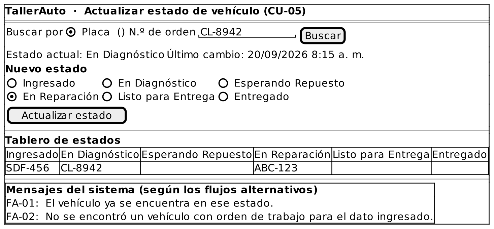

# Caso de Uso: CU-05 — Actualizar Estado de Vehículo

### Código
`CU-05`

### Issue
[CU-05 en GitHub](https://github.com/IF-6100-2026/TallerAuto-docs/issues/11)

### Requerimiento funcional que atiende
[RF-05 — Tablero de control de flujo de trabajo](../02-requerimientos/funcionales/RF-05-tablero-control-flujo.md)

### Descripción
Actualiza el estado operativo de un vehículo entre los seis estados permitidos (*Ingresado, En Diagnóstico, Esperando Repuesto, En Reparación, Listo para Entrega, Entregado*) y registra la fecha y la hora de cada cambio. Atiende al requerimiento **RF-05**.

### Actores
- **Primarios**: Administrador del Taller, Mecánico
- **Secundarios**: Cliente

### Precondiciones
El vehículo se encuentra en el taller con una orden de trabajo registrada.

### Postcondiciones
- **Éxito**: El vehículo queda con el nuevo estado, la fecha y hora del cambio quedan registradas en su recorrido histórico, y el tablero de estados refleja el cambio.
- **Falla**: El estado del vehículo no cambia.

### Flujo Principal
1. El Administrador o el Mecánico solicita actualizar el estado de un vehículo.
2. El Administrador o el Mecánico ubica el vehículo por placa o por número de orden de trabajo.
3. El sistema despliega el estado actual del vehículo y los seis estados posibles.
4. El Administrador o el Mecánico selecciona el nuevo estado.
5. El sistema verifica que el nuevo estado sea distinto del estado actual.
6. El sistema registra el nuevo estado con la fecha y la hora del cambio.
7. El sistema actualiza el tablero de estados y confirma el cambio.

### Flujos Alternativos

#### FA-01: Estado igual al vigente
1. En el paso 5 del flujo principal, el sistema determina que el estado seleccionado es el que el vehículo ya tiene.
2. El sistema informa "El vehículo ya se encuentra en ese estado."
3. El flujo regresa al paso 4 del flujo principal.

#### FA-02: Vehículo u orden no encontrados
1. En el paso 2 del flujo principal, el sistema determina que no existe un vehículo con orden de trabajo asociado a la placa o al número indicado.
2. El sistema informa "No se encontró un vehículo con orden de trabajo para el dato ingresado."
3. El flujo regresa al paso 2 del flujo principal.

### Prototipos

Prototipo editable: [`CU-05.puml`](prototipos/CU-05.puml). Los mensajes que muestra el prototipo son los de los flujos alternativos de este caso de uso.

### Requerimientos Especiales
Ninguno.

### Escenarios de Prueba

Guion Gherkin ejecutable: [`pruebas/CU-05.feature`](../04-pruebas/CU-05.feature)

| Entrada | Salida Esperada |
|---------|-----------------|
| **E1 · Flujo principal.** El usuario selecciona el estado "En Reparación" para la orden de trabajo #102 (vehículo en "En Diagnóstico"). | El sistema registra el nuevo estado con la fecha y la hora, y actualiza el tablero. |
| **E2 · FA-01.** El vehículo de la orden #102 está en "En Reparación" y el usuario selecciona "En Reparación". | El sistema informa "El vehículo ya se encuentra en ese estado." y no registra ningún cambio. |
| **E3 · FA-02.** El usuario busca la placa "ZZZ-000", sin orden de trabajo. | El sistema informa "No se encontró un vehículo con orden de trabajo para el dato ingresado." y solicita ubicar el vehículo de nuevo. |

---

**Documento Preparado Por:** José A Ramírez  
**Fecha:** 19/09/2026
