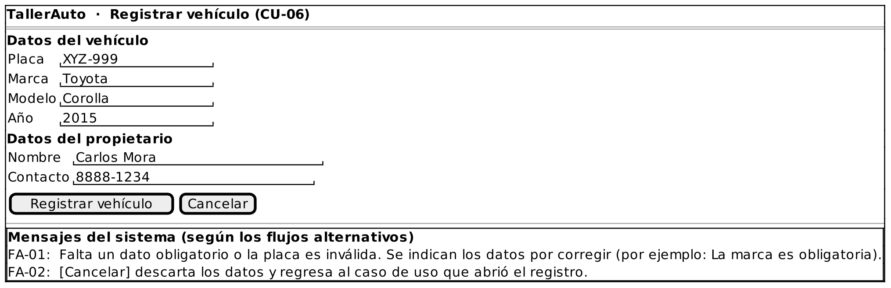

# Caso de Uso: CU-06 — Registrar Vehículo

### Código
`CU-06`

### Issue
[CU-06 en GitHub](https://github.com/IF-6100-2026/TallerAuto-docs/issues/12)

### Requerimiento funcional que atiende
[RF-01 — Consulta del historial de servicio por placa](../02-requerimientos/funcionales/RF-01-consulta-historial-vehicular.md) (registro del vehículo cuando la placa no está registrada)

### Descripción
Registra un vehículo y su propietario para abrir el expediente del vehículo. Se ejecuta como extensión de CU-01, CU-04 y CU-07 cuando la placa no está registrada. Atiende al requerimiento **RF-01** (registro del vehículo cuando la placa no está registrada).

### Actores
- **Primarios**: Administrador del Taller, Mecánico
- **Secundarios**: Cliente (aporta los datos del vehículo y de su propiedad)

### Precondiciones
La placa del vehículo no está registrada en el sistema.

### Postcondiciones
- **Éxito**: El vehículo queda registrado, asociado a su propietario, con un expediente sin servicios.
- **Falla / Cancelación**: No se registra el vehículo ni el propietario.

### Flujo Principal
1. El Administrador o el Mecánico ingresa los datos del vehículo: placa, marca, modelo y año.
2. El Administrador o el Mecánico ingresa los datos del propietario: nombre y datos de contacto.
3. El sistema verifica que los datos estén completos y que la placa tenga un formato válido.
4. El sistema registra el vehículo asociado a su propietario y crea su expediente.
5. El sistema confirma el registro.

### Flujos Alternativos

#### FA-01: Datos incompletos o inválidos
1. En el paso 3 del flujo principal, el sistema determina que falta un dato obligatorio o que la placa tiene un formato inválido.
2. El sistema indica los datos por corregir.
3. El flujo regresa al paso 1 del flujo principal.

#### FA-02: Cancelación del registro
1. En cualquier momento previo al paso 4 del flujo principal, el Administrador o el Mecánico solicita cancelar el registro.
2. El sistema descarta los datos ingresados.
3. El caso de uso termina y el control regresa al caso de uso que lo extendió.

### Prototipos

Prototipo editable: [`CU-06.puml`](prototipos/CU-06.puml). Los mensajes que muestra el prototipo son los de los flujos alternativos de este caso de uso.

### Requerimientos Especiales
Ninguno.

### Escenarios de Prueba

Guion Gherkin ejecutable: [`pruebas/CU-06.feature`](../04-pruebas/CU-06.feature)

| Entrada | Salida Esperada |
|---------|-----------------|
| **E1 · Flujo principal.** Placa "XYZ-999", marca "Toyota", modelo "Corolla", año 2015, propietario "Carlos Mora" con teléfono. | El sistema registra el vehículo asociado al propietario, crea el expediente sin servicios y confirma el registro. |
| **E2 · FA-01.** Los mismos datos que E1, pero sin la marca. | El sistema indica que la marca es obligatoria, no registra el vehículo y solicita corregir los datos. |
| **E3 · FA-02.** El usuario ingresa parte de los datos y cancela el registro. | El sistema descarta los datos y no registra el vehículo. |

---

**Documento Preparado Por:** José A Ramírez  
**Fecha:** 19/09/2026
