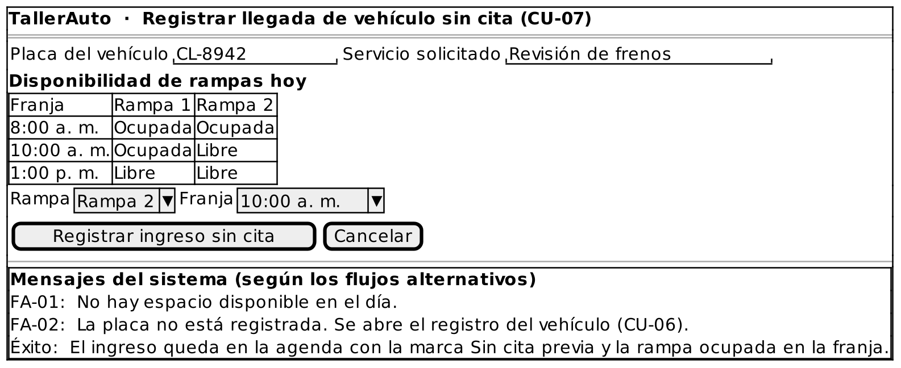

# Caso de Uso: CU-07 — Registrar Llegada de Vehículo sin Cita

### Código
`CU-07`

### Issue
[CU-07 en GitHub](https://github.com/IF-6100-2026/TallerAuto-docs/issues/13)

### Requerimiento funcional que atiende
[RF-04 — Planificador de citas y asignación de rampas](../02-requerimientos/funcionales/RF-04-planificador-rampas.md)

### Descripción
Registra el ingreso de un vehículo que llega al taller sin cita previa, en una rampa y una franja horaria libres del día. Extiende a CU-04. Atiende al requerimiento **RF-04**.

### Actores
- **Primarios**: Administrador del Taller
- **Secundarios**: Cliente

### Precondiciones
Las rampas y el horario del taller están configurados.

### Postcondiciones
- **Éxito**: El vehículo queda en la agenda del día, en una rampa y una franja libres, con la marca "Sin cita previa".
- **Falla**: El ingreso no queda registrado y la agenda no cambia.

### Flujo Principal
1. El administrador indica que un cliente llegó sin cita previa.
2. El administrador indica la placa del vehículo y el servicio solicitado.
3. El sistema despliega la disponibilidad de las rampas del día por franja horaria.
4. El administrador selecciona una rampa y una franja horaria libres.
5. El sistema registra el ingreso en la agenda del día con la marca "Sin cita previa".
6. El sistema bloquea la rampa para esa franja y confirma el ingreso.

### Flujos Alternativos

#### FA-01: Sin espacio disponible
1. En el paso 3 del flujo principal, el sistema determina que no hay rampas libres en el día.
2. El sistema informa "No hay espacio disponible en el día."
3. El caso de uso termina sin cambios.

#### FA-02: Vehículo no registrado
1. En el paso 2 del flujo principal, el sistema determina que la placa indicada no está registrada.
2. El sistema ejecuta CU-06 Registrar Vehículo (`<<extend>>`, punto de extensión: "placa no registrada").
3. Al finalizar CU-06, el flujo regresa al paso 2 del flujo principal.

### Prototipos

Prototipo editable: [`CU-07.puml`](prototipos/CU-07.puml). Los mensajes que muestra el prototipo son los de los flujos alternativos de este caso de uso.

### Requerimientos Especiales
Ninguno.

### Escenarios de Prueba

Guion Gherkin ejecutable: [`pruebas/CU-07.feature`](../04-pruebas/CU-07.feature)

| Entrada | Salida Esperada |
|---------|-----------------|
| **E1 · Flujo principal.** Llega el vehículo "CL-8942" sin cita, servicio "Revisión de frenos", y el administrador selecciona la Rampa 2 a las 10:00 a. m. (libre). | El sistema registra el ingreso en la agenda del día con la marca "Sin cita previa" y marca la Rampa 2 como ocupada en esa franja. |
| **E2 · FA-01.** Llega un vehículo sin cita y todas las rampas del día están ocupadas. | El sistema informa "No hay espacio disponible en el día." y no registra el ingreso. |
| **E3 · FA-02.** Llega sin cita el vehículo con placa no registrada "XYZ-999". | El sistema ejecuta CU-06 y, al terminar, continúa con el registro de la llegada. |

---

**Documento Preparado Por:** José A Ramírez  
**Fecha:** 19/09/2026
