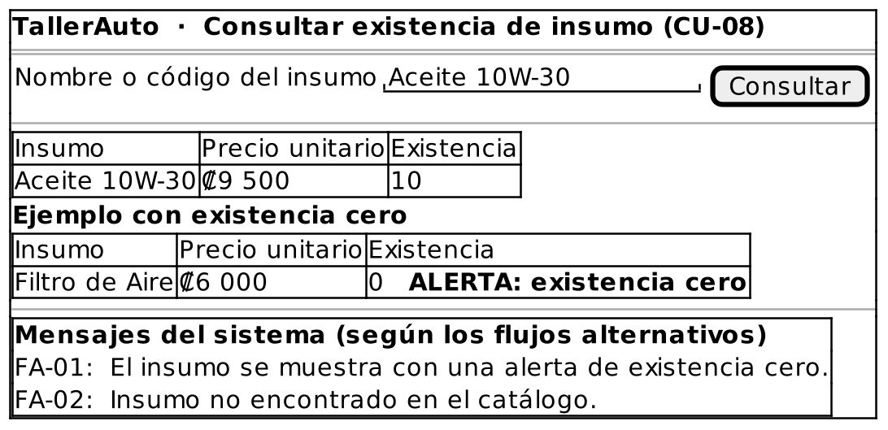

# Caso de Uso: CU-08 — Consultar Existencia de Insumo

### Código
`CU-08`

### Issue
[CU-08 en GitHub](https://github.com/IF-6100-2026/TallerAuto-docs/issues/14)

### Requerimiento funcional que atiende
[RF-03 — Catálogo de insumos y control de existencias](../02-requerimientos/funcionales/RF-03-catalogo-insumos.md)

### Descripción
Consulta el precio unitario y la existencia disponible de un insumo del catálogo, con alerta cuando la existencia es cero. Es incluido por CU-02 y CU-03. Atiende al requerimiento **RF-03**.

### Actores
- **Primarios**: Administrador del Taller, Mecánico
- **Secundarios**: Ninguno

### Precondiciones
Ninguna.

### Postcondiciones
- **Éxito**: El sistema despliega el nombre, el precio unitario y la existencia del insumo.
- **Falla**: El sistema no despliega ningún insumo.

### Flujo Principal
1. El Administrador o el Mecánico solicita consultar la existencia de un insumo.
2. El Administrador o el Mecánico indica el nombre o el código del insumo.
3. El sistema busca el insumo en el catálogo.
4. El sistema despliega el nombre, el precio unitario y la existencia disponible.

### Flujos Alternativos

#### FA-01: Existencia en cero
1. En el paso 4 del flujo principal, el sistema determina que la existencia del insumo es cero.
2. El sistema despliega el insumo con una alerta de existencia cero.
3. El caso de uso termina.

#### FA-02: Insumo no encontrado
1. En el paso 3 del flujo principal, el sistema determina que el insumo no existe en el catálogo.
2. El sistema informa "Insumo no encontrado en el catálogo."
3. El flujo regresa al paso 2 del flujo principal.

### Prototipos

Prototipo editable: [`CU-08.puml`](prototipos/CU-08.puml). Los mensajes que muestra el prototipo son los de los flujos alternativos de este caso de uso.

### Requerimientos Especiales
- La consulta debe responder en menos de 5 segundos (RS-02).

### Escenarios de Prueba

Guion Gherkin ejecutable: [`pruebas/CU-08.feature`](../04-pruebas/CU-08.feature)

| Entrada | Salida Esperada |
|---------|-----------------|
| **E1 · Flujo principal.** El usuario consulta "Aceite 10W-30" (existencia 10). | El sistema despliega nombre, precio unitario y existencia 10 en menos de 5 segundos. |
| **E2 · FA-01.** El usuario consulta "Filtro de Aire" (existencia 0). | El sistema despliega el insumo con una alerta de existencia cero. |
| **E3 · FA-02.** El usuario consulta "Bujía-ZZZ", que no existe. | El sistema informa "Insumo no encontrado en el catálogo." y solicita indicar el insumo de nuevo. |

---

**Documento Preparado Por:** José A Ramírez  
**Fecha:** 19/09/2026
