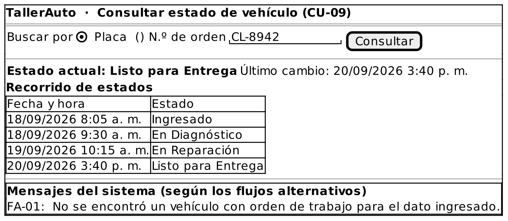

# Caso de Uso: CU-09 — Consultar Estado de Vehículo

### Código
`CU-09`

### Issue
[CU-09 en GitHub](https://github.com/IF-6100-2026/TallerAuto-docs/issues/15)

### Requerimiento funcional que atiende
[RF-05 — Tablero de control de flujo de trabajo](../02-requerimientos/funcionales/RF-05-tablero-control-flujo.md)

### Descripción
Consulta el estado actual de un vehículo y su recorrido histórico de estados, por placa o por número de orden de trabajo. Atiende al requerimiento **RF-05**.

### Actores
- **Primarios**: Administrador del Taller, Mecánico
- **Secundarios**: Cliente (solicita la información desde recepción)

### Precondiciones
El vehículo tiene una orden de trabajo registrada.

### Postcondiciones
- **Éxito**: El sistema despliega el estado actual del vehículo y su recorrido histórico de estados.
- **Falla**: El sistema no despliega información del vehículo.

### Flujo Principal
1. El Administrador o el Mecánico solicita consultar el estado de un vehículo.
2. El Administrador o el Mecánico ingresa la placa o el número de orden de trabajo.
3. El sistema busca el vehículo o la orden.
4. El sistema despliega el estado actual del vehículo con la fecha y la hora de su último cambio.
5. El sistema despliega el recorrido histórico de estados, con la fecha y la hora de cada cambio.

### Flujos Alternativos

#### FA-01: Vehículo u orden no encontrados
1. En el paso 3 del flujo principal, el sistema determina que no existe un vehículo con orden de trabajo asociado al dato ingresado.
2. El sistema informa "No se encontró un vehículo con orden de trabajo para el dato ingresado."
3. El flujo regresa al paso 2 del flujo principal.

### Prototipos

Prototipo editable: [`CU-09.puml`](prototipos/CU-09.puml). Los mensajes que muestra el prototipo son los de los flujos alternativos de este caso de uso.

### Requerimientos Especiales
- La consulta debe responder en menos de 5 segundos (RS-02).
- Un operador sin experiencia previa debe completar la consulta sin ayuda, tras 15 minutos de explicación (RS-03).

### Escenarios de Prueba

Guion Gherkin ejecutable: [`pruebas/CU-09.feature`](../04-pruebas/CU-09.feature)

| Entrada | Salida Esperada |
|---------|-----------------|
| **E1 · Flujo principal, por placa.** Un administrador consulta la placa "CL-8942" desde recepción. | El sistema despliega el estado actual (por ejemplo "Listo para Entrega") y el recorrido de estados en menos de 5 segundos. |
| **E2 · Flujo principal, por orden.** Un mecánico consulta la orden #102. | El sistema despliega el estado actual y el recorrido de estados de esa orden. |
| **E3 · FA-01.** El usuario consulta la placa "ZZZ-000", sin orden de trabajo. | El sistema informa "No se encontró un vehículo con orden de trabajo para el dato ingresado." y solicita el dato de nuevo. |
| **E4 · RS-03.** Un operador sin experiencia, con 15 minutos de explicación, consulta el estado de un vehículo sin ayuda. | El operador completa la consulta sin asistencia. |

---

**Documento Preparado Por:** José A Ramírez  
**Fecha:** 19/09/2026
