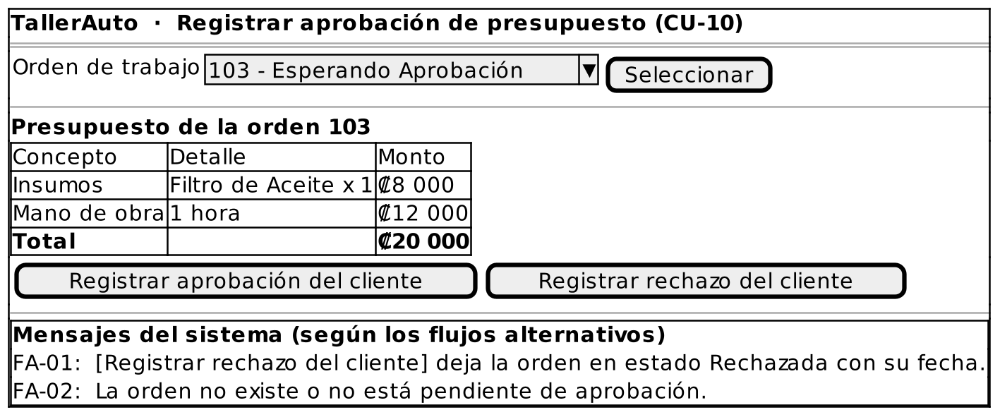

# Caso de Uso: CU-10 — Registrar Aprobación de Presupuesto

### Código
`CU-10`

### Issue
[CU-10 en GitHub](https://github.com/IF-6100-2026/TallerAuto-docs/issues/16)

### Requerimiento funcional que atiende
[RF-02 — Elaboración de presupuestos desglosados](../02-requerimientos/funcionales/RF-02-cotizacion-y-cobro.md) (decisión del cliente sobre el presupuesto)

### Descripción
Registra la decisión del cliente (aprobación o rechazo) sobre el presupuesto de una orden de trabajo. Atiende al requerimiento **RF-02** (elaborar y confirmar el presupuesto).

### Actores
- **Primarios**: Administrador del Taller
- **Secundarios**: Cliente (aprueba o rechaza el presupuesto)

### Precondiciones
Existe una orden de trabajo en estado "Esperando Aprobación".

### Postcondiciones
- **Éxito**: La orden queda en estado "Aprobada", con la fecha de aprobación registrada.
- **Falla / Rechazo**: Si el cliente rechaza el presupuesto, la orden queda en estado "Rechazada". En cualquier otra falla, el estado de la orden no cambia.

### Flujo Principal
1. El administrador solicita registrar la decisión del cliente sobre un presupuesto.
2. El administrador selecciona la orden de trabajo.
3. El sistema despliega el presupuesto desglosado (insumos, mano de obra y total).
4. El administrador registra la aprobación del cliente.
5. El sistema cambia el estado de la orden a "Aprobada" y registra la fecha.
6. El sistema confirma el registro.

### Flujos Alternativos

#### FA-01: Presupuesto rechazado por el cliente
1. En el paso 4 del flujo principal, el administrador registra el rechazo del cliente.
2. El sistema cambia el estado de la orden a "Rechazada" y registra la fecha.
3. El caso de uso termina.

#### FA-02: Orden no encontrada o no pendiente
1. En el paso 2 del flujo principal, el sistema determina que la orden no existe o que no está en estado "Esperando Aprobación".
2. El sistema informa "La orden no existe o no está pendiente de aprobación."
3. El flujo regresa al paso 2 del flujo principal.

### Prototipos

Prototipo editable: [`CU-10.puml`](prototipos/CU-10.puml). Los mensajes que muestra el prototipo son los de los flujos alternativos de este caso de uso.

### Requerimientos Especiales
Ninguno.

### Escenarios de Prueba

Guion Gherkin ejecutable: [`pruebas/CU-10.feature`](../04-pruebas/CU-10.feature)

| Entrada | Salida Esperada |
|---------|-----------------|
| **E1 · Flujo principal.** Orden #103 "Esperando Aprobación" con total de ₡20 000, aprobada por el cliente. | El sistema cambia el estado a "Aprobada" y registra la fecha. |
| **E2 · FA-01.** Orden #103 "Esperando Aprobación", rechazada por el cliente. | El sistema cambia el estado a "Rechazada" y registra la fecha. |
| **E3 · FA-02.** El administrador selecciona la orden #101, ya "Aprobada". | El sistema informa "La orden no existe o no está pendiente de aprobación." y solicita seleccionar otra orden. |

---

**Documento Preparado Por:** José A Ramírez  
**Fecha:** 19/09/2026
