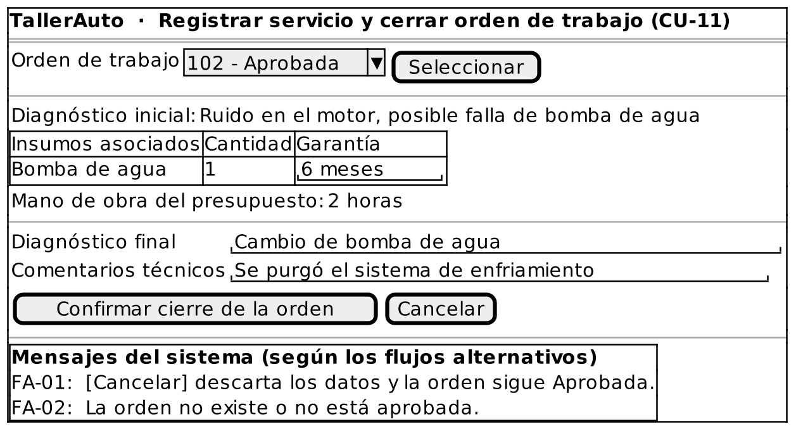

# Caso de Uso: CU-11 — Registrar Servicio y Cerrar Orden de Trabajo

### Código
`CU-11`

### Issue
[CU-11 en GitHub](https://github.com/IF-6100-2026/TallerAuto-docs/issues/17)

### Requerimiento funcional que atiende
[RF-01 — Consulta del historial de servicio por placa](../02-requerimientos/funcionales/RF-01-consulta-historial-vehicular.md) (criterio 3: el servicio queda en el expediente al cerrar la orden)

### Descripción
Registra el diagnóstico final, los comentarios técnicos y la garantía de los insumos utilizados, y cierra la orden de trabajo para que el servicio quede en el historial del vehículo. Atiende al requerimiento **RF-01** (criterio 3).

### Actores
- **Primarios**: Administrador del Taller, Mecánico
- **Secundarios**: Ninguno

### Precondiciones
Existe una orden de trabajo en estado "Aprobada".

### Postcondiciones
- **Éxito**: La orden queda en estado "Cerrada" y el servicio (diagnóstico final, insumos utilizados y garantía) queda en el historial del vehículo.
- **Falla / Cancelación**: La orden sigue en estado "Aprobada" y el historial no cambia.

### Flujo Principal
1. El Administrador o el Mecánico solicita cerrar una orden de trabajo.
2. El Administrador o el Mecánico selecciona la orden de trabajo.
3. El sistema despliega el diagnóstico inicial, los insumos asociados a la orden y la mano de obra del presupuesto.
4. El Administrador o el Mecánico registra el diagnóstico final y los comentarios técnicos.
5. El Administrador o el Mecánico registra la garantía de cada insumo utilizado.
6. El Administrador o el Mecánico confirma el cierre de la orden.
7. El sistema registra el servicio en el historial del vehículo.
8. El sistema cambia el estado de la orden a "Cerrada" y confirma el cierre.

### Flujos Alternativos

#### FA-01: Cancelación del cierre
1. En cualquier momento previo al paso 6 del flujo principal, el Administrador o el Mecánico solicita cancelar el cierre.
2. El sistema descarta los datos ingresados y la orden permanece en estado "Aprobada".
3. El caso de uso termina.

#### FA-02: Orden no encontrada o no cerrable
1. En el paso 2 del flujo principal, el sistema determina que la orden no existe o que no está en estado "Aprobada".
2. El sistema informa "La orden no existe o no está aprobada."
3. El flujo regresa al paso 2 del flujo principal.

### Prototipos

Prototipo editable: [`CU-11.puml`](prototipos/CU-11.puml). Los mensajes que muestra el prototipo son los de los flujos alternativos de este caso de uso.

### Requerimientos Especiales
Ninguno.

### Escenarios de Prueba

Guion Gherkin ejecutable: [`pruebas/CU-11.feature`](../04-pruebas/CU-11.feature)

| Entrada | Salida Esperada |
|---------|-----------------|
| **E1 · Flujo principal.** Orden #102 "Aprobada". Diagnóstico final "Cambio de bomba de agua", garantía de 6 meses para la bomba, y el usuario confirma el cierre. | El sistema registra el servicio en el historial del vehículo y cambia la orden a "Cerrada". Al consultar el historial (CU-01), el servicio aparece con su garantía. |
| **E2 · FA-01.** El usuario ingresa el diagnóstico final y cancela el cierre. | La orden sigue "Aprobada" y el historial del vehículo no cambia. |
| **E3 · FA-02.** El usuario selecciona la orden #103, en estado "Esperando Aprobación". | El sistema informa "La orden no existe o no está aprobada." y solicita seleccionar otra orden. |

---

**Documento Preparado Por:** José A Ramírez  
**Fecha:** 19/09/2026
