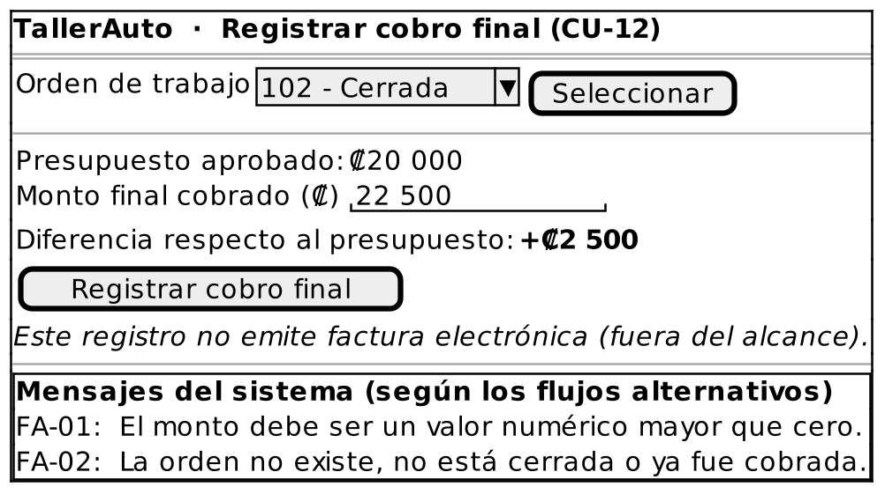

# Caso de Uso: CU-12 — Registrar Cobro Final

### Código
`CU-12`

### Issue
[CU-12 en GitHub](https://github.com/IF-6100-2026/TallerAuto-docs/issues/18)

### Requerimiento funcional que atiende
[RF-02 — Elaboración de presupuestos desglosados](../02-requerimientos/funcionales/RF-02-cotizacion-y-cobro.md) (criterio 3: cobro final y diferencia contra el presupuesto)

### Descripción
Registra el monto final cobrado por una orden de trabajo cerrada y lo compara contra el presupuesto aprobado. No emite factura electrónica (fuera del alcance 1.3). Atiende al requerimiento **RF-02** (criterio 3).

### Actores
- **Primarios**: Administrador del Taller
- **Secundarios**: Cliente (paga el monto final)

### Precondiciones
Existe una orden de trabajo en estado "Cerrada" sin cobro final registrado.

### Postcondiciones
- **Éxito**: Queda registrado el monto final cobrado y su diferencia respecto del presupuesto aprobado.
- **Falla**: No se registra el cobro final.

### Flujo Principal
1. El administrador solicita registrar el cobro final de una orden de trabajo.
2. El administrador selecciona la orden de trabajo.
3. El sistema despliega el presupuesto aprobado de la orden.
4. El administrador ingresa el monto final cobrado al cliente.
5. El sistema calcula la diferencia entre el monto final y el presupuesto aprobado.
6. El sistema registra el cobro final y despliega la diferencia.

### Flujos Alternativos

#### FA-01: Monto inválido
1. En el paso 4 del flujo principal, el sistema determina que el monto ingresado no es un valor numérico mayor que cero.
2. El sistema informa "El monto debe ser un valor numérico mayor que cero."
3. El flujo regresa al paso 4 del flujo principal.

#### FA-02: Orden no encontrada o no cobrable
1. En el paso 2 del flujo principal, el sistema determina que la orden no existe, que no está en estado "Cerrada" o que ya tiene un cobro final registrado.
2. El sistema informa "La orden no existe, no está cerrada o ya fue cobrada."
3. El flujo regresa al paso 2 del flujo principal.

### Prototipos

Prototipo editable: [`CU-12.puml`](prototipos/CU-12.puml). Los mensajes que muestra el prototipo son los de los flujos alternativos de este caso de uso.

### Requerimientos Especiales
Ninguno.

### Escenarios de Prueba

Guion Gherkin ejecutable: [`pruebas/CU-12.feature`](../04-pruebas/CU-12.feature)

| Entrada | Salida Esperada |
|---------|-----------------|
| **E1 · Flujo principal, con diferencia.** Orden #102 "Cerrada", presupuesto aprobado de ₡20 000, monto final cobrado de ₡22 500. | El sistema registra el cobro y despliega una diferencia de +₡2 500. |
| **E2 · Flujo principal, sin diferencia.** Orden #104 "Cerrada", presupuesto de ₡20 000, monto final de ₡20 000. | El sistema registra el cobro y despliega una diferencia de ₡0. |
| **E3 · FA-01.** El administrador ingresa un monto de -₡5 000. | El sistema informa "El monto debe ser un valor numérico mayor que cero." y solicita el monto de nuevo. |
| **E4 · FA-02.** El administrador selecciona la orden #103, en estado "Esperando Aprobación". | El sistema informa "La orden no existe, no está cerrada o ya fue cobrada." y solicita seleccionar otra orden. |

---

**Documento Preparado Por:** José A Ramírez  
**Fecha:** 19/09/2026
