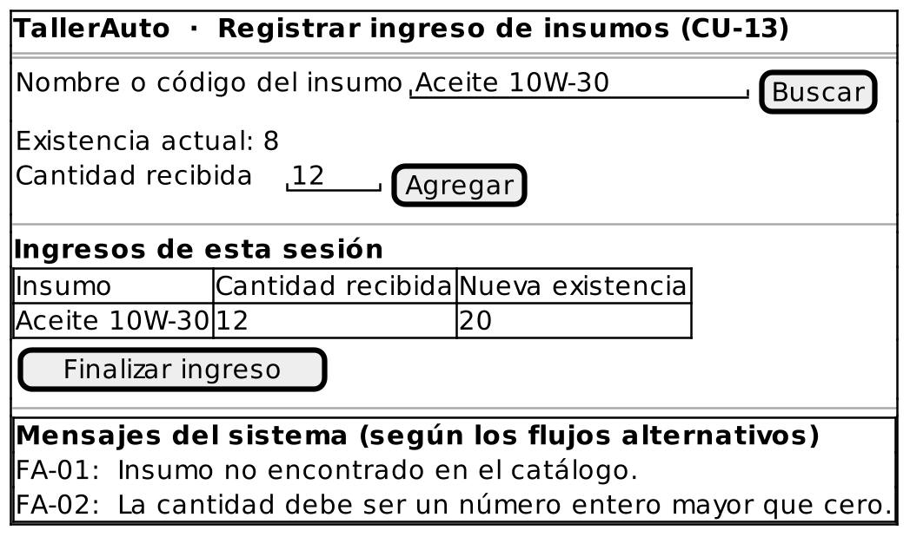

# Caso de Uso: CU-13 — Registrar Ingreso de Insumos

### Código
`CU-13`

### Issue
[CU-13 en GitHub](https://github.com/IF-6100-2026/TallerAuto-docs/issues/19)

### Requerimiento funcional que atiende
[RF-03 — Catálogo de insumos y control de existencias](../02-requerimientos/funcionales/RF-03-catalogo-insumos.md) (reposición de existencias)

### Descripción
Registra la entrada de insumos recibidos (compra o reposición) y suma la cantidad a sus existencias. Atiende al requerimiento **RF-03** (reposición de existencias).

### Actores
- **Primarios**: Administrador del Taller
- **Secundarios**: Ninguno

### Precondiciones
Ninguna.

### Postcondiciones
- **Éxito**: La existencia de cada insumo registrado aumenta en la cantidad recibida.
- **Falla**: Las existencias no cambian.

### Flujo Principal
1. El administrador solicita registrar el ingreso de insumos.
2. El administrador indica el nombre o el código del insumo recibido.
3. El sistema busca el insumo en el catálogo.
4. El administrador indica la cantidad recibida.
5. El sistema suma la cantidad a la existencia del insumo.
6. El sistema despliega la nueva existencia.
7. El administrador repite los pasos 2 a 6 hasta registrar todos los insumos recibidos.
8. El sistema confirma el ingreso registrado.

### Flujos Alternativos

#### FA-01: Insumo no encontrado
1. En el paso 3 del flujo principal, el sistema determina que el insumo no existe en el catálogo.
2. El sistema informa "Insumo no encontrado en el catálogo."
3. El flujo regresa al paso 2 del flujo principal.

#### FA-02: Cantidad inválida
1. En el paso 4 del flujo principal, el sistema determina que la cantidad no es un número entero mayor que cero.
2. El sistema informa "La cantidad debe ser un número entero mayor que cero."
3. El flujo regresa al paso 4 del flujo principal.

### Prototipos

Prototipo editable: [`CU-13.puml`](prototipos/CU-13.puml). Los mensajes que muestra el prototipo son los de los flujos alternativos de este caso de uso.

### Requerimientos Especiales
Ninguno.

### Escenarios de Prueba

Guion Gherkin ejecutable: [`pruebas/CU-13.feature`](../04-pruebas/CU-13.feature)

| Entrada | Salida Esperada |
|---------|-----------------|
| **E1 · Flujo principal.** El administrador registra el ingreso de 12 unidades de "Aceite 10W-30" (existencia 8). | El sistema suma 12 unidades y despliega la nueva existencia de 20. |
| **E2 · FA-01.** El administrador indica el insumo "Bujía-ZZZ", que no existe. | El sistema informa "Insumo no encontrado en el catálogo." y solicita indicar el insumo de nuevo. |
| **E3 · FA-02.** El administrador indica una cantidad de 0 para "Aceite 10W-30". | El sistema informa "La cantidad debe ser un número entero mayor que cero.", no modifica la existencia y solicita la cantidad de nuevo. |

---

**Documento Preparado Por:** José A Ramírez  
**Fecha:** 19/09/2026
