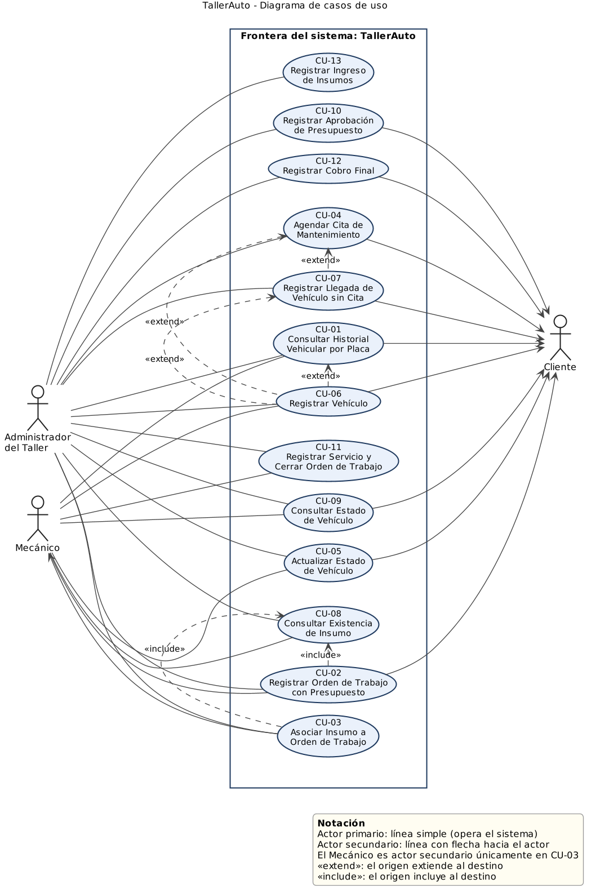
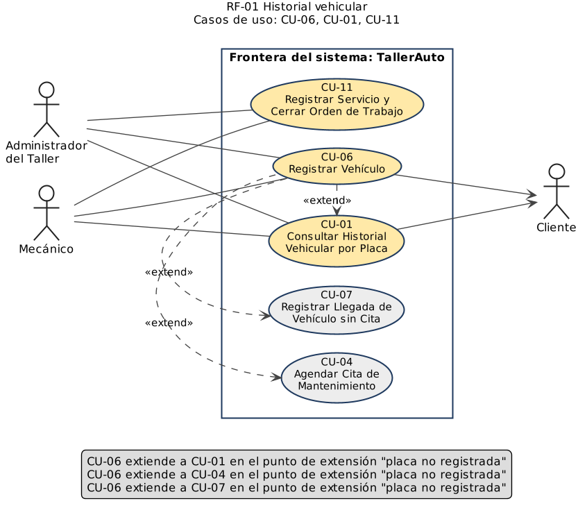
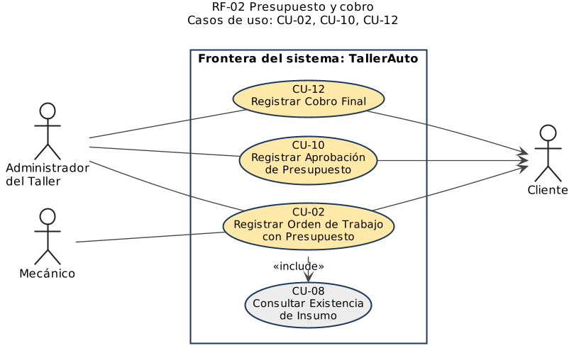
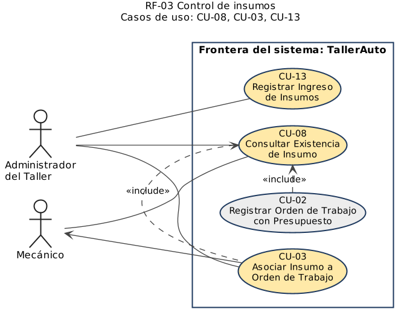
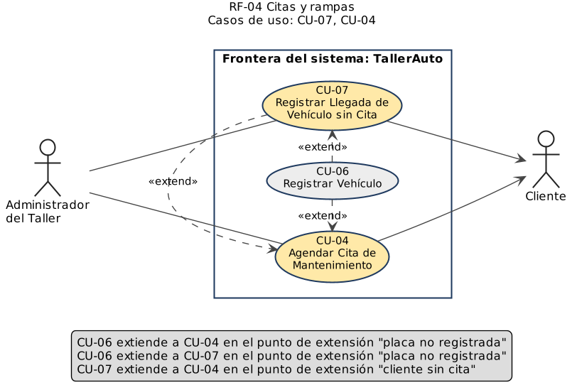
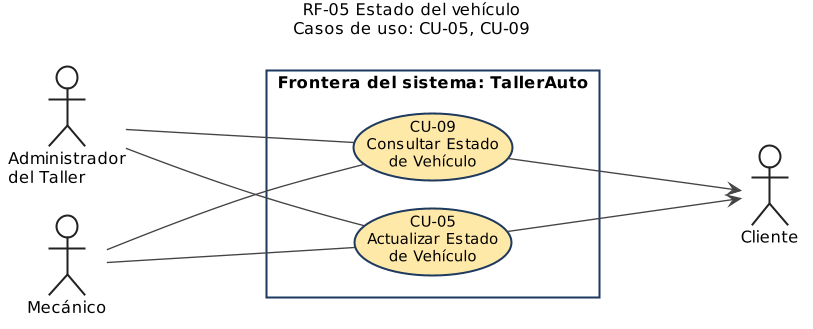

# Actores y diagrama de casos de uso

Los actores son **roles**, no personas. Un mismo rol puede ser ejercido por más de una persona (por ejemplo, Nacho y Chalo ejercen el rol Mecánico).

## Actores del sistema

| Actor | Tipo | Rol respecto al sistema | Casos de uso asociados |
|---|---|---|---|
| **Administrador del Taller** (rol que ejerce Don Chepe, dueño y administrador) | Primario en los 13 casos de uso | Opera el sistema desde la computadora de recepción. Registra vehículos y órdenes de trabajo, elabora presupuestos, agenda citas y recibe vehículos sin cita, controla los insumos, registra la aprobación del presupuesto y el cobro final, y consulta y actualiza el estado de los vehículos. Es el único rol que puede confirmar o modificar un presupuesto. | [CU-01](CU-01-consultar-historial-vehicular.md), [CU-02](CU-02-registrar-orden-con-presupuesto.md), [CU-03](CU-03-asociar-insumo-a-orden.md), [CU-04](CU-04-agendar-cita-de-mantenimiento.md), [CU-05](CU-05-actualizar-estado-de-vehiculo.md), [CU-06](CU-06-registrar-vehiculo.md), [CU-07](CU-07-registrar-llegada-sin-cita.md), [CU-08](CU-08-consultar-existencia-de-insumo.md), [CU-09](CU-09-consultar-estado-de-vehiculo.md), [CU-10](CU-10-registrar-aprobacion-de-presupuesto.md), [CU-11](CU-11-registrar-servicio-y-cerrar-orden.md), [CU-12](CU-12-registrar-cobro-final.md), [CU-13](CU-13-registrar-ingreso-de-insumos.md) |
| **Mecánico** (rol que ejercen Nacho y Chalo) | Primario en 7 casos de uso; secundario en CU-03 | Opera el sistema para consultar el historial de un vehículo, registrar el diagnóstico y los insumos requeridos de una orden, consultar la existencia de insumos, actualizar y consultar el estado del vehículo en el que trabaja y registrar el servicio al cerrar la orden. No puede confirmar ni modificar un presupuesto: esa acción queda reservada al rol Administrador (ver [RS-01](../02-requerimientos/suplementarios/RS-01-seguridad-control-acceso.md)). En CU-03 solo informa al Administrador los insumos utilizados. | Primario: [CU-01](CU-01-consultar-historial-vehicular.md), [CU-02](CU-02-registrar-orden-con-presupuesto.md), [CU-05](CU-05-actualizar-estado-de-vehiculo.md), [CU-06](CU-06-registrar-vehiculo.md), [CU-08](CU-08-consultar-existencia-de-insumo.md), [CU-09](CU-09-consultar-estado-de-vehiculo.md), [CU-11](CU-11-registrar-servicio-y-cerrar-orden.md). Secundario: [CU-03](CU-03-asociar-insumo-a-orden.md) |
| **Cliente** | Secundario en 9 casos de uso | Dueño o conductor del vehículo. No opera el sistema: reporta fallas, aporta los datos del vehículo, aprueba o rechaza presupuestos, paga y solicita información desde recepción. Dispara o recibe el resultado de la interacción. | [CU-01](CU-01-consultar-historial-vehicular.md), [CU-02](CU-02-registrar-orden-con-presupuesto.md), [CU-04](CU-04-agendar-cita-de-mantenimiento.md), [CU-05](CU-05-actualizar-estado-de-vehiculo.md), [CU-06](CU-06-registrar-vehiculo.md), [CU-07](CU-07-registrar-llegada-sin-cita.md), [CU-09](CU-09-consultar-estado-de-vehiculo.md), [CU-10](CU-10-registrar-aprobacion-de-presupuesto.md), [CU-12](CU-12-registrar-cobro-final.md) |

## Control de acceso por rol

El sistema distingue con qué rol opera cada usuario (Administrador o Mecánico) antes de habilitar las acciones de cada caso de uso. Ambos roles pueden registrar diagnósticos, insumos y cambios de estado de un vehículo, pero la confirmación y el ajuste manual de un presupuesto (CU-02, pasos 8 y FA-02) quedan reservados exclusivamente al rol Administrador. El detalle del requerimiento y su justificación están en [RS-01 — Seguridad: control de acceso por roles](../02-requerimientos/suplementarios/RS-01-seguridad-control-acceso.md).

## Diagrama de casos de uso

- Código fuente PlantUML: [`diagrama-casos-de-uso.puml`](diagrama-casos-de-uso.puml)

**Notación.** Actor primario: línea simple. Actor secundario: línea con flecha hacia el actor. La frontera del sistema es el rectángulo **TallerAuto**.

## Relaciones entre casos de uso

| Tipo | Origen | Destino | Punto de extensión o motivo |
|---|---|---|---|
| `<<include>>` | CU-02 Registrar Orden de Trabajo con Presupuesto | CU-08 Consultar Existencia de Insumo | Paso 4 del flujo principal: toda orden verifica la existencia de cada insumo. |
| `<<include>>` | CU-03 Asociar Insumo a Orden de Trabajo | CU-08 Consultar Existencia de Insumo | Paso 4 del flujo principal: se despliega la existencia antes de descontar. |
| `<<extend>>` | CU-06 Registrar Vehículo | CU-01 Consultar Historial Vehicular por Placa | "placa no registrada" (FA-01 de CU-01) |
| `<<extend>>` | CU-06 Registrar Vehículo | CU-04 Agendar Cita de Mantenimiento | "placa no registrada" (FA-02 de CU-04) |
| `<<extend>>` | CU-06 Registrar Vehículo | CU-07 Registrar Llegada de Vehículo sin Cita | "placa no registrada" (FA-02 de CU-07) |
| `<<extend>>` | CU-07 Registrar Llegada de Vehículo sin Cita | CU-04 Agendar Cita de Mantenimiento | "cliente sin cita" (FA-03 de CU-04) |

En `<<include>>` la flecha sale del caso base hacia el incluido. En `<<extend>>` la flecha sale del caso que extiende hacia el caso base.

## Diagramas por requerimiento funcional

En amarillo, los casos de uso del requerimiento. En gris, casos de otros requerimientos con los que tienen una relación `include` o `extend`.

| RF | Diagrama | Imagen exportada |
|---|---|---|
| RF-01 | [`diagramas/RF-01.puml`](diagramas/RF-01.puml) |  |
| RF-02 | [`diagramas/RF-02.puml`](diagramas/RF-02.puml) |  |
| RF-03 | [`diagramas/RF-03.puml`](diagramas/RF-03.puml) |  |
| RF-04 | [`diagramas/RF-04.puml`](diagramas/RF-04.puml) |  |
| RF-05 | [`diagramas/RF-05.puml`](diagramas/RF-05.puml) |  |

---

**Documento Preparado Por:** Adrián Barboza Vargas  
**Fecha:** 21 de septiembre de 2026
