# TallerAuto — Documentación

**Sistema de Gestión Integral para Taller Mecánico de Barrio (TallerAuto)**

Universidad de Costa Rica · Sede del Atlántico · Recinto de Paraíso
Curso: IF-6100 — Análisis y Diseño de Software
Profesor: MSc. Leonardo Camacho Navarro
Ciclo Lectivo: II Ciclo 2026

Índice navegable de toda la documentación del proyecto. La estructura sigue las fases del curso: inicio → requerimientos → casos de uso → pruebas → diseño → configuración.

## Registro de cambios

- [`cambios-pc1-pc2.md`](cambios-pc1-pc2.md) — qué observación del PC1 se atendió, cómo y en qué archivo.

## 01 — Inicio

- [Problema y visión del sistema](01-inicio/problema-y-vision.md)
- [Diagrama de contexto](01-inicio/diagrama-de-contexto.md) — fuente editable ([`diagrama-de-contexto.drawio`](01-inicio/diagrama-de-contexto.drawio)) e imagen exportada, con la tabla de flujos (origen, destino, dato, caso de uso).
- Modelado del problema con BPMN 2.0: un diagrama por requerimiento funcional, ligado al RF que origina.

  | RF | Diagrama | Imagen exportada |
  |---|---|---|
  | RF-01 | [`01-inicio/bpmn/RF-01-consulta-historial-vehicular.bpmn`](01-inicio/bpmn/RF-01-consulta-historial-vehicular.bpmn) | 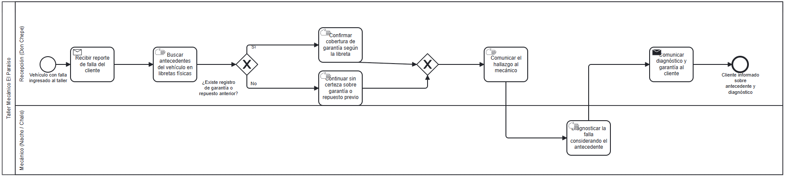 |
  | RF-02 | [`01-inicio/bpmn/RF-02-cotizacion-y-cobro.bpmn`](01-inicio/bpmn/RF-02-cotizacion-y-cobro.bpmn) | 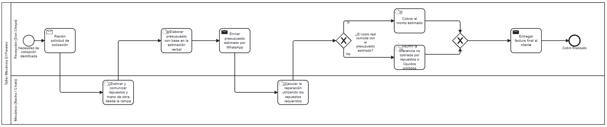 |
  | RF-03 | [`01-inicio/bpmn/RF-03-verificacion-uso-repuestos.bpmn`](01-inicio/bpmn/RF-03-verificacion-uso-repuestos.bpmn) | 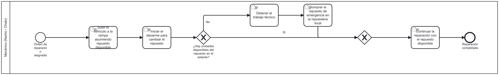 |
  | RF-04 | [`01-inicio/bpmn/RF-04-agendamiento-citas-rampas.bpmn`](01-inicio/bpmn/RF-04-agendamiento-citas-rampas.bpmn) | 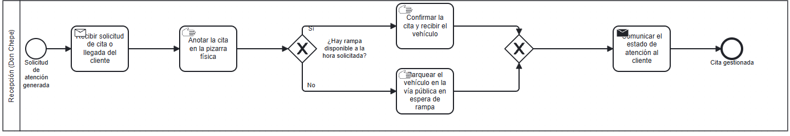 |
  | RF-05 | [`01-inicio/bpmn/RF-05-consulta-estado-vehiculo.bpmn`](01-inicio/bpmn/RF-05-consulta-estado-vehiculo.bpmn) | 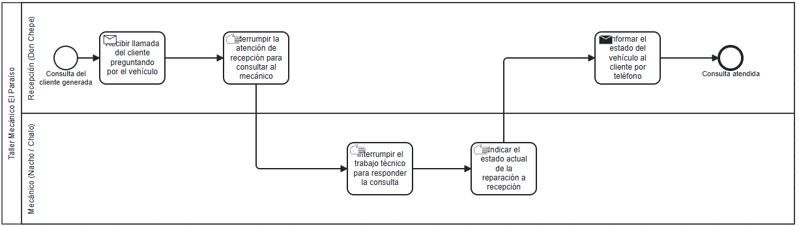 |

  Trazabilidad proceso BPMN → requerimiento funcional, detalle completo: [`01-inicio/bpmn/trazabilidad-bpmn-rf.md`](01-inicio/bpmn/trazabilidad-bpmn-rf.md).

## 02 — Requerimientos

- Requerimientos funcionales:
  - [RF-01 — Consulta del historial de servicio por placa](02-requerimientos/funcionales/RF-01-consulta-historial-vehicular.md)
  - [RF-02 — Elaboración de presupuestos desglosados](02-requerimientos/funcionales/RF-02-cotizacion-y-cobro.md)
  - [RF-03 — Catálogo de insumos y control de existencias](02-requerimientos/funcionales/RF-03-catalogo-insumos.md)
  - [RF-04 — Planificador de citas y asignación de rampas](02-requerimientos/funcionales/RF-04-planificador-rampas.md)
  - [RF-05 — Tablero de control de flujo de trabajo](02-requerimientos/funcionales/RF-05-tablero-control-flujo.md)
- Requerimientos suplementarios:
  - [RS-01 — Seguridad: control de acceso por roles](02-requerimientos/suplementarios/RS-01-seguridad-control-acceso.md)
  - [RS-02 — Tiempo de respuesta en la consulta del historial vehicular](02-requerimientos/suplementarios/RS-02-tiempo-respuesta-historial.md)
  - [RS-03 — Usabilidad: aprendizaje del sistema sin capacitación formal](02-requerimientos/suplementarios/RS-03-aprendizaje-sin-capacitacion.md)
- Trazabilidad requerimiento → caso de uso → escenarios: [`02-requerimientos/trazabilidad-rf-cu.md`](02-requerimientos/trazabilidad-rf-cu.md)

## 03 — Casos de uso

- Convenciones del equipo y supuestos del análisis pendientes de confirmar con Don Chepe: [`03-casos-de-uso/README.md`](03-casos-de-uso/README.md)
- Actores del sistema, roles y control de acceso: [`03-casos-de-uso/actores.md`](03-casos-de-uso/actores.md)
- Diagrama general de casos de uso: 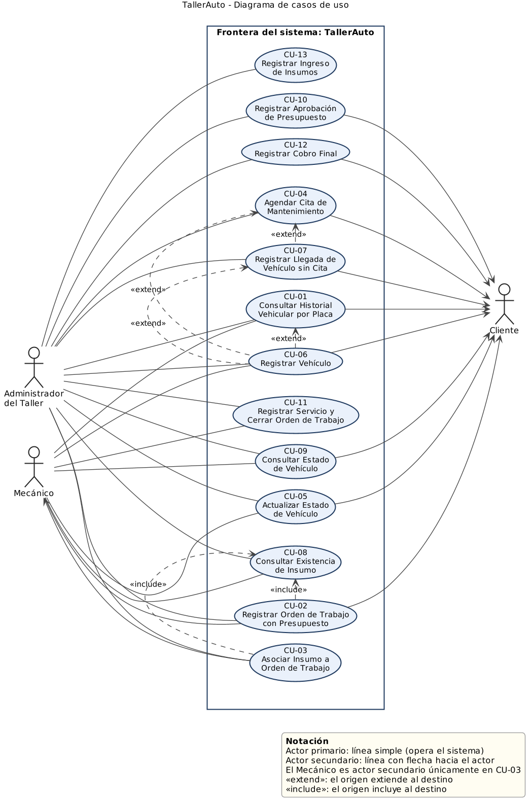 — fuente: [`03-casos-de-uso/diagrama-casos-de-uso.puml`](03-casos-de-uso/diagrama-casos-de-uso.puml)
- Diagramas por requerimiento funcional (en amarillo, los casos del requerimiento; en gris, casos de otros requerimientos con relación `include` o `extend`):

  | RF | Diagrama | Imagen exportada |
  |---|---|---|
  | RF-01 | [`03-casos-de-uso/diagramas/RF-01.puml`](03-casos-de-uso/diagramas/RF-01.puml) | 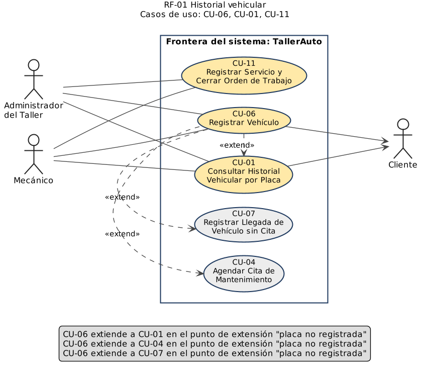 |
  | RF-02 | [`03-casos-de-uso/diagramas/RF-02.puml`](03-casos-de-uso/diagramas/RF-02.puml) | 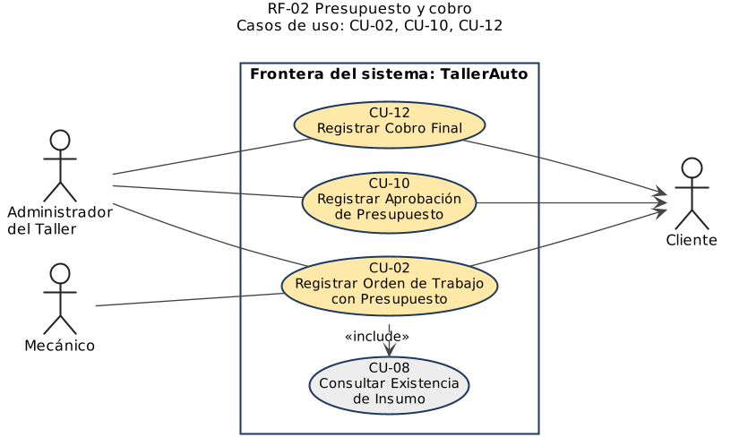 |
  | RF-03 | [`03-casos-de-uso/diagramas/RF-03.puml`](03-casos-de-uso/diagramas/RF-03.puml) | 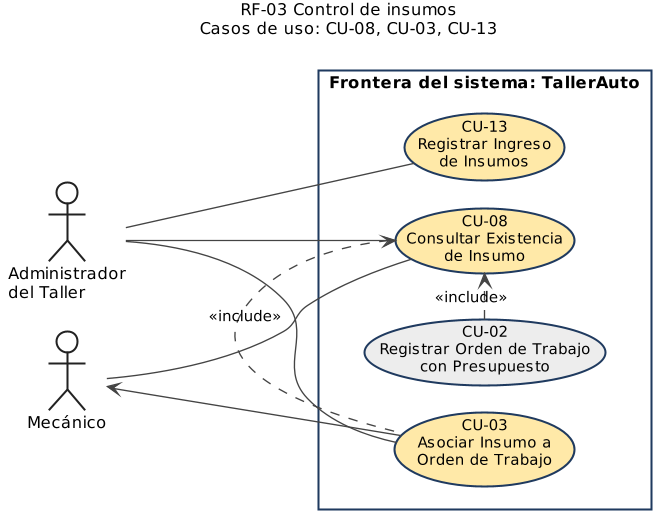 |
  | RF-04 | [`03-casos-de-uso/diagramas/RF-04.puml`](03-casos-de-uso/diagramas/RF-04.puml) | 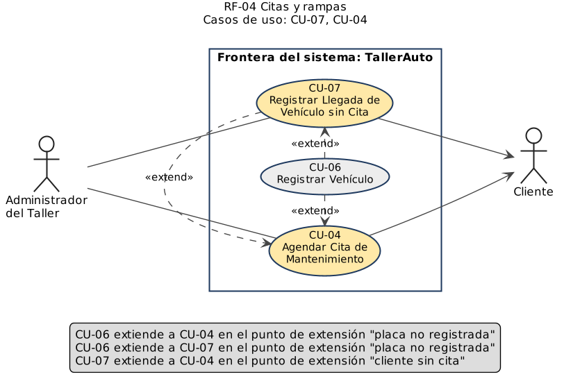 |
  | RF-05 | [`03-casos-de-uso/diagramas/RF-05.puml`](03-casos-de-uso/diagramas/RF-05.puml) | 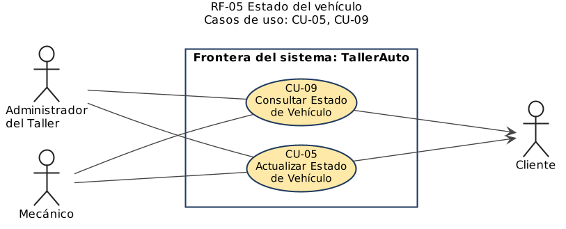 |

- Detalle de cada caso de uso, con su prototipo y guion de pruebas:

  | CU | Nombre | RF | Detalle | Prototipo | Guion de pruebas |
  |---|---|---|---|---|---|
  | CU-01 | Consultar Historial Vehicular por Placa | RF-01 | [`03-casos-de-uso/CU-01-consultar-historial-vehicular.md`](03-casos-de-uso/CU-01-consultar-historial-vehicular.md) | [`03-casos-de-uso/prototipos/CU-01.png`](03-casos-de-uso/prototipos/CU-01.png) | [`04-pruebas/CU-01.feature`](04-pruebas/CU-01.feature) |
  | CU-02 | Registrar Orden de Trabajo con Presupuesto | RF-02 | [`03-casos-de-uso/CU-02-registrar-orden-con-presupuesto.md`](03-casos-de-uso/CU-02-registrar-orden-con-presupuesto.md) | [`03-casos-de-uso/prototipos/CU-02.png`](03-casos-de-uso/prototipos/CU-02.png) | [`04-pruebas/CU-02.feature`](04-pruebas/CU-02.feature) |
  | CU-03 | Asociar Insumo a Orden de Trabajo | RF-03 | [`03-casos-de-uso/CU-03-asociar-insumo-a-orden.md`](03-casos-de-uso/CU-03-asociar-insumo-a-orden.md) | [`03-casos-de-uso/prototipos/CU-03.png`](03-casos-de-uso/prototipos/CU-03.png) | [`04-pruebas/CU-03.feature`](04-pruebas/CU-03.feature) |
  | CU-04 | Agendar Cita de Mantenimiento | RF-04 | [`03-casos-de-uso/CU-04-agendar-cita-de-mantenimiento.md`](03-casos-de-uso/CU-04-agendar-cita-de-mantenimiento.md) | [`03-casos-de-uso/prototipos/CU-04.png`](03-casos-de-uso/prototipos/CU-04.png) | [`04-pruebas/CU-04.feature`](04-pruebas/CU-04.feature) |
  | CU-05 | Actualizar Estado de Vehículo | RF-05 | [`03-casos-de-uso/CU-05-actualizar-estado-de-vehiculo.md`](03-casos-de-uso/CU-05-actualizar-estado-de-vehiculo.md) | [`03-casos-de-uso/prototipos/CU-05.png`](03-casos-de-uso/prototipos/CU-05.png) | [`04-pruebas/CU-05.feature`](04-pruebas/CU-05.feature) |
  | CU-06 | Registrar Vehículo | RF-01 | [`03-casos-de-uso/CU-06-registrar-vehiculo.md`](03-casos-de-uso/CU-06-registrar-vehiculo.md) | [`03-casos-de-uso/prototipos/CU-06.png`](03-casos-de-uso/prototipos/CU-06.png) | [`04-pruebas/CU-06.feature`](04-pruebas/CU-06.feature) |
  | CU-07 | Registrar Llegada de Vehículo sin Cita | RF-04 | [`03-casos-de-uso/CU-07-registrar-llegada-sin-cita.md`](03-casos-de-uso/CU-07-registrar-llegada-sin-cita.md) | [`03-casos-de-uso/prototipos/CU-07.png`](03-casos-de-uso/prototipos/CU-07.png) | [`04-pruebas/CU-07.feature`](04-pruebas/CU-07.feature) |
  | CU-08 | Consultar Existencia de Insumo | RF-03 | [`03-casos-de-uso/CU-08-consultar-existencia-de-insumo.md`](03-casos-de-uso/CU-08-consultar-existencia-de-insumo.md) | [`03-casos-de-uso/prototipos/CU-08.png`](03-casos-de-uso/prototipos/CU-08.png) | [`04-pruebas/CU-08.feature`](04-pruebas/CU-08.feature) |
  | CU-09 | Consultar Estado de Vehículo | RF-05 | [`03-casos-de-uso/CU-09-consultar-estado-de-vehiculo.md`](03-casos-de-uso/CU-09-consultar-estado-de-vehiculo.md) | [`03-casos-de-uso/prototipos/CU-09.png`](03-casos-de-uso/prototipos/CU-09.png) | [`04-pruebas/CU-09.feature`](04-pruebas/CU-09.feature) |
  | CU-10 | Registrar Aprobación de Presupuesto | RF-02 | [`03-casos-de-uso/CU-10-registrar-aprobacion-de-presupuesto.md`](03-casos-de-uso/CU-10-registrar-aprobacion-de-presupuesto.md) | [`03-casos-de-uso/prototipos/CU-10.png`](03-casos-de-uso/prototipos/CU-10.png) | [`04-pruebas/CU-10.feature`](04-pruebas/CU-10.feature) |
  | CU-11 | Registrar Servicio y Cerrar Orden de Trabajo | RF-01 | [`03-casos-de-uso/CU-11-registrar-servicio-y-cerrar-orden.md`](03-casos-de-uso/CU-11-registrar-servicio-y-cerrar-orden.md) | [`03-casos-de-uso/prototipos/CU-11.png`](03-casos-de-uso/prototipos/CU-11.png) | [`04-pruebas/CU-11.feature`](04-pruebas/CU-11.feature) |
  | CU-12 | Registrar Cobro Final | RF-02 | [`03-casos-de-uso/CU-12-registrar-cobro-final.md`](03-casos-de-uso/CU-12-registrar-cobro-final.md) | [`03-casos-de-uso/prototipos/CU-12.png`](03-casos-de-uso/prototipos/CU-12.png) | [`04-pruebas/CU-12.feature`](04-pruebas/CU-12.feature) |
  | CU-13 | Registrar Ingreso de Insumos | RF-03 | [`03-casos-de-uso/CU-13-registrar-ingreso-de-insumos.md`](03-casos-de-uso/CU-13-registrar-ingreso-de-insumos.md) | [`03-casos-de-uso/prototipos/CU-13.png`](03-casos-de-uso/prototipos/CU-13.png) | [`04-pruebas/CU-13.feature`](04-pruebas/CU-13.feature) |

## 04 — Pruebas

13 guiones en Gherkin (`.feature`) que cubren el flujo principal y todos los flujos alternativos de cada caso de uso, además de los escenarios derivados de los requerimientos suplementarios. Convenciones de etiquetado, cobertura por caso de uso y el registro de ejecución manual (53 escenarios): [`04-pruebas/README.md`](04-pruebas/README.md).

## 05 — Diseño

- [Arquitectura — propuesta de diseño](05-diseno/arquitectura.md): estilo arquitectónico justificado, vista de componentes y la realización de CU-02 capa por capa.
- [Lineamientos de diseño — Backend](05-diseno/lineamientos-backend.md)
- [Lineamientos de diseño — Base de datos](05-diseno/lineamientos-base-de-datos.md)
- [Lineamientos de diseño — Frontend](05-diseno/lineamientos-frontend.md)

## 06 — Configuración

- [Ambiente de desarrollo](06-configuracion/ambiente-de-desarrollo.md): versiones requeridas, pasos para levantar base de datos, backend y frontend, y cómo verificar que funciona.

---

**Elaborado por:**
- Jared Morales Morales (Carné: C4H714)
- José Andrés Ramírez Jiménez (Carné: C4I788)
- Adrián Barboza Vargas (Carné: C20979)
