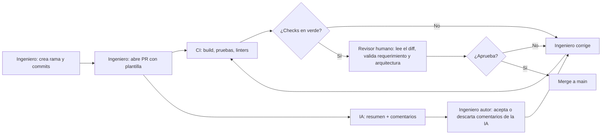

# Code reviews y pull requests con IA

**Curso:** IF-6100 Análisis y Diseño de Sistemas · II Ciclo 2026
**Tema:** 3. Code reviews y pull requests con IA
**Integrantes:**
- [Nombre 1]
- Jared Morales Morales
- [Nombre 3]

**Repositorio de la demostración:** https://github.com/jaredCR10/code-reviews-y-pull-requests-con-ia-demo

---

## 1. Glosario
<!-- Responsable: [Nombre 1] · Cada término con palabras propias, relación con el tema y referencia [n] -->

| Término | Definición | Fuente |
|---|---|---|
| Pull request | | |
| Code review | | |
| Revisor automático con IA | | |
| CI/CD | | |
| Branch protection | | |
| Status check | | |
| Linter / análisis estático | | |
| Falso positivo / falso negativo | | |
| Rubber-stamping | | |

## 2. Punto de partida del análisis
<!-- Responsable: [Nombre 1] · Preguntas iniciales, primeras fuentes y decisiones de alcance -->

## 3. Importancia de la revisión de código y el pull request como artefacto
<!-- Responsable: [Nombre 1] · Objetivos de la revisión; descripción, plantilla, tamaño y criterios de aceptación del PR -->

## 4. Herramientas utilizadas y su contexto
<!-- Responsable: Jared · Por herramienta: propósito, tipo, cuota gratuita, limitaciones y por qué se eligió (no es comparación) -->

| Herramienta | Tipo | Propósito en el flujo | Modalidad gratuita | Limitaciones encontradas |
|---|---|---|---|---|
| GitHub (PR + branch protection) | Plataforma | | | |
| GitHub Actions | CI | | | |
| Checkstyle / ESLint | Análisis estático | | | |
| CodeRabbit | Revisor de IA | | | |

## 5. Participación del CI/CD en la revisión
<!-- Responsable: Jared · Qué valida el pipeline y qué reglas bloquean el merge -->

## 6. Proceso aplicado en la prueba
<!-- Responsable: Jared · Paso a paso reproducible, con enlaces a PRs y ejecuciones de Actions -->

### 6.1 Diagrama del flujo

### 6.2 División de labores

| Paso | Labor | Responsable (Ingeniero / IA / CI) | Punto de verificación del ingeniero |
|---|---|---|---|
| 1 | | | |

### 6.3 Paso a paso

## 7. Responsabilidades del revisor humano y del revisor de IA
<!-- Responsable: [Nombre 1] · Matriz de responsabilidades; cómo evitar aprobar sin leer -->

## 8. Comunicación y resolución de conflictos en revisiones
<!-- Responsable: [Nombre 1] -->

## 9. Hallazgos
<!-- Responsable: [Nombre 3] · Con evidencia: qué funcionó, qué falló, errores de la IA, riesgos, tiempo -->

### 9.1 Resultados del PR sembrado

| Defecto plantado | ¿Lo detectó el CI? | ¿Lo detectó la IA? | ¿Lo detectó el humano? | Evidencia |
|---|---|---|---|---|
| Violación de estilo | | | | |
| Prueba que falla | | | | |
| Credencial en el código | | | | |
| Null pointer / caso borde | | | | |
| Regla de negocio incumplida | | | | |
| Violación de arquitectura en capas | | | | |

## 10. Conclusiones y recomendaciones para el proyecto del curso
<!-- Responsable: [Nombre 3] -->

## 11. Referencias
<!-- Todos · Formato consistente (APA) -->

1.
