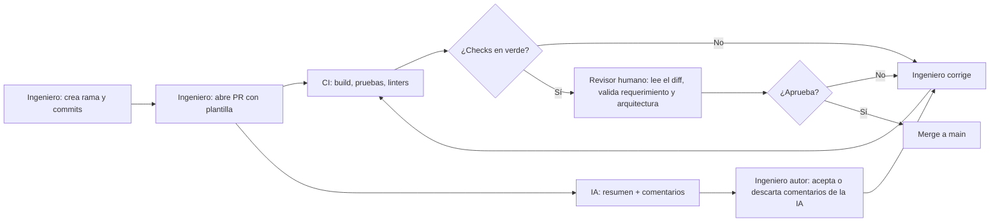

# Code reviews y pull requests con IA

**Curso:** IF-6100 Análisis y Diseño de Sistemas · II Ciclo 2026
**Tema:** 3. Code reviews y pull requests con IA
**Integrantes:**
- [Nombre 1]
- Jared Morales Morales
- [Nombre 3]

**Repositorio de la demostración:** https://github.com/jaredCR10/code-reviews-y-pull-requests-con-ia-demo

---

## 1. Glosario
<!-- Responsable: [Nombre 1] · Cada término con palabras propias, relación con el tema y referencia [n] -->

| Término | Definición | Fuente |
|---|---|---|
| Pull request | | |
| Code review | | |
| Revisor automático con IA | | |
| CI/CD | | |
| Branch protection | | |
| Status check | | |
| Linter / análisis estático | | |
| Falso positivo / falso negativo | | |
| Rubber-stamping | | |

## 2. Punto de partida del análisis
<!-- Responsable: [Nombre 1] · Preguntas iniciales, primeras fuentes y decisiones de alcance -->

## 3. Importancia de la revisión de código y el pull request como artefacto
<!-- Responsable: [Nombre 1] · Objetivos de la revisión; descripción, plantilla, tamaño y criterios de aceptación del PR -->

## 4. Herramientas utilizadas y su contexto
<!-- Responsable: Jared Morales -->

El objetivo no fue comparar herramientas, sino armar un flujo donde cada una cumple un papel distinto dentro de la revisión. Se eligieron herramientas que el equipo ya usaba (GitHub) o que tienen un plan gratuito suficiente para un repositorio público, que es una condición del trabajo.

| Herramienta | Tipo | Papel en el flujo | Modalidad gratuita usada | Limitaciones encontradas |
|---|---|---|---|---|
| **GitHub** (pull requests y rulesets) | Plataforma de control de versiones | Aloja el repositorio, el PR como artefacto de revisión y las reglas que bloquean el merge | Cuenta gratuita, repositorio público | No permite aprobar el propio PR, así que con un solo integrante no se puede cumplir la regla de aprobación. Al configurar el ruleset hay que indicar la rama objetivo; si no, la regla queda creada pero no se aplica |
| **GitHub Actions** | Integración continua (CI) | Compila, ejecuta pruebas y verifica estándares en cada PR; sus resultados son *status checks* obligatorios | Minutos ilimitados en repositorios públicos | Advierte que las acciones `checkout@v4` y `setup-node@v4` usan Node 20, que está obsoleto en los *runners* |
| **Maven Checkstyle Plugin** | Análisis estático (Java) | Verifica el estándar de código del backend: imports, nombres, llaves, bloques vacíos | Software libre | Se usó un conjunto reducido de reglas para no obligar a reescribir el código existente. No revisa lógica ni arquitectura |
| **Vitest** (vía Angular CLI) | Pruebas unitarias del frontend | Ejecuta las pruebas del frontend dentro del CI | Software libre | El proyecto no tenía ESLint configurado, así que el estándar de TypeScript todavía no se verifica en el CI (queda como trabajo pendiente) |
| **CodeRabbit** | Revisor automático con IA | Resume el PR, deja comentarios línea por línea y responde cuando se le menciona con `@coderabbitai`. Se configuró para que **comente pero nunca apruebe** | Plan gratuito para repositorios públicos (open source) | No revisó automáticamente el PR que ya estaba abierto antes de instalarlo, y su aviso indicaba otra causa. Cuota de 10 revisiones por hora. Marcó como "Major" un comentario que era una preferencia |
| **Claude** (asistente de IA, plan Pro de un integrante) | Asistente de apoyo | Se usó para **preparar** la infraestructura: redactar el workflow y la configuración, y abrir los PRs de configuración. **No forma parte del flujo demostrado**, que se puede reproducir sin él | No es gratuito; se declara por transparencia | Cometió un error de configuración (el alcance de los lineamientos en CodeRabbit) que luego detectó el revisor de IA (ver 6.3, paso 5) |

**Por qué un repositorio aparte.** Se trabajó sobre una copia pública del proyecto del curso (TallerAuto), en el repositorio `code-reviews-y-pull-requests-con-ia-demo`. Así se usa código real sin afectar el repositorio del curso, que es privado y pertenece a la organización del curso. Además, el plan gratuito de CodeRabbit solo hace revisiones completas en repositorios públicos.

## 5. Participación del CI/CD en la revisión
<!-- Responsable: Jared Morales -->

En este flujo el CI funciona como un **revisor automático que no opina, sino que verifica**. Antes de que una persona lea el código, GitHub Actions ejecuta el workflow [`.github/workflows/ci.yml`](https://github.com/jaredCR10/code-reviews-y-pull-requests-con-ia-demo/blob/main/.github/workflows/ci.yml) en cada PR hacia `main`, con dos *jobs* en paralelo:

| Job | Qué verifica | Comando |
|---|---|---|
| `backend` | 1. Estándar de código Java (Checkstyle)   2. Que el proyecto compile y que pasen las pruebas (con base de datos H2 en memoria, sin necesidad de MySQL) | `./mvnw checkstyle:check`   `./mvnw verify` |
| `frontend` | Que el proyecto Angular instale sus dependencias, compile y pase sus pruebas | `npm ci`   `npm run build`   `npm test -- --watch=false` |

**Reglas que bloquean la integración.** En `main` se configuró un *ruleset* de GitHub con estas reglas:

| Regla | Efecto |
|---|---|
| Exigir pull request | Nadie puede hacer push directo a `main`, ni siquiera el administrador |
| 1 aprobación | Otra persona, distinta del autor, debe aprobar |
| Descartar aprobaciones viejas | Si el autor sube commits después de una aprobación, esta se anula y hay que revisar de nuevo. Evita que entre código que nadie leyó |
| *Status checks* obligatorios: `backend` y `frontend` | No se puede hacer merge si alguno falla |
| Bloquear borrado y *force push* | Protege el historial de `main` |

Se verificó que las reglas funcionan intentando un push directo a `main`: GitHub lo rechazó con el error `GH013: Repository rule violations`, indicando que los cambios deben entrar por PR y que faltan los 2 checks obligatorios (ver `evidencia/`).

**Tiempo del CI.** En las 6 ejecuciones registradas, cada *job* tardó entre 17 y 46 segundos. El CI da retroalimentación casi inmediata, mucho antes de que un revisor humano abra el PR.

**División con los otros revisores.** El CI se encarga de lo que se puede verificar con reglas exactas: compila o no compila, la prueba pasa o falla, el estilo se cumple o no. Así, el revisor de IA y el humano no gastan tiempo en eso y se concentran en lo que requiere criterio.

## 6. Proceso aplicado en la prueba
<!-- Responsable: Jared Morales -->

**Repositorio:** https://github.com/jaredCR10/code-reviews-y-pull-requests-con-ia-demo

### 6.1 Diagrama del flujo

### 6.2 División de labores

| Paso | Labor | Responsable | Punto de verificación del ingeniero |
|---|---|---|---|
| 1 | Crear una rama para el cambio y hacer los commits | Ingeniero (autor) | — |
| 2 | Abrir el PR con descripción: qué cambia, por qué y cómo se probó | Ingeniero (autor) | — |
| 3 | Compilar, ejecutar pruebas y verificar estándares | CI | El autor revisa el resultado de los checks |
| 4 | Resumir el PR y comentar posibles problemas | IA (CodeRabbit) | — |
| 5 | Evaluar cada comentario de la IA: **aceptar** (y corregir) o **descartar** con justificación | Ingeniero (autor) | ✅ **Verifica** cada comentario contra el código y la documentación; no acepta nada sin comprobarlo |
| 6 | Corregir lo aceptado y volver a subir | Ingeniero (autor) | El CI y la IA revisan de nuevo |
| 7 | Leer el diff completo, validar el requerimiento y la arquitectura | Ingeniero (revisor, otra persona) | ✅ **Aprueba** o pide cambios |
| 8 | Bloquear el merge si falta la aprobación o un check | GitHub (ruleset) | — |
| 9 | Hacer el merge a `main` | Ingeniero | ✅ Decisión final humana |

**Regla central:** la IA comenta, el CI verifica y **solo un humano aprueba**. La IA quedó configurada con `request_changes_workflow: false`, así que no puede aprobar ni bloquear un PR.

### 6.3 Paso a paso

Horas en tiempo de Costa Rica (UTC−6), 31 de octubre y 1 de noviembre de 2026.

**Preparación del entorno (antes de activar la protección).** Estos commits se hicieron directo a `main` porque el repositorio estaba vacío y todavía no había reglas:

1. **Copia del proyecto.** Se creó el repositorio público y se copió el código del proyecto TallerAuto sin su historial (commit [`d88c79d`](https://github.com/jaredCR10/code-reviews-y-pull-requests-con-ia-demo/commit/d88c79d)). Antes de publicarlo se revisó que la configuración no tuviera credenciales reales: solo contiene contraseñas de desarrollo local, y el archivo `.env` está en `.gitignore`.
2. **Estructura de la entrega.** Se agregó la carpeta `investigacion/` (commit [`fd55198`](https://github.com/jaredCR10/code-reviews-y-pull-requests-con-ia-demo/commit/fd55198)).

**PR #1: agregar el CI y el revisor de IA** ([enlace](https://github.com/jaredCR10/code-reviews-y-pull-requests-con-ia-demo/pull/1)), rama `ci/pipeline-revision`.

3. **Apertura (13:54).** Se abrió el PR con el workflow, Checkstyle y `.coderabbit.yaml`. Las instrucciones para la IA se tomaron de los lineamientos del propio proyecto (`docs/05-diseno/lineamientos-*.md`), por ejemplo: un controlador nunca accede a un repositorio y en Angular está prohibido el tipo `any`.
4. **El CI detecta un error que ya existía.** El job `backend` pasó, pero `frontend` falló ([ejecución](https://github.com/jaredCR10/code-reviews-y-pull-requests-con-ia-demo/actions/runs/41344091941)). La causa no estaba en el PR: la prueba `app.spec.ts`, generada por Angular, esperaba el título `"Hello, frontend"`, pero el equipo lo había cambiado a `"TallerAuto"` sin actualizar la prueba. Como nadie corría las pruebas de forma automática, el error había pasado desapercibido.
5. **Revisión de la IA.** CodeRabbit no revisó el PR de forma automática porque se instaló cuando el PR ya estaba abierto. El ingeniero lo solicitó con el comando `@coderabbitai review`. La IA generó un resumen, una evaluación de seguridad (riesgo bajo) y 3 comentarios:

   | Comentario de la IA | Verificación del ingeniero | Decisión |
   |---|---|---|
   | Configurar `auto_pause_after_reviewed_commits: 0` para que nunca pause las revisiones ([enlace](https://github.com/jaredCR10/code-reviews-y-pull-requests-con-ia-demo/pull/1#discussion_r4437184345)) | Es cierto según la documentación, pero la misma documentación advierte que gasta la cuota más rápido. Nuestros PRs tienen pocos commits | **Descartado** con justificación. La IA respondió que retiraba la recomendación y marcó la conversación como resuelta |
   | Los lineamientos de `docs/` no se aplican al código de `backend/` y `frontend/` ([enlace](https://github.com/jaredCR10/code-reviews-y-pull-requests-con-ia-demo/pull/1#discussion_r4437184352)) | Correcto: la documentación indica que un archivo de lineamientos solo aplica a su propia carpeta. El error venía de la configuración preparada con ayuda de Claude | **Aceptado**, corregido en el mismo PR (commit [`c19c365`](https://github.com/jaredCR10/code-reviews-y-pull-requests-con-ia-demo/commit/c19c365)) |
   | Corregir la prueba del frontend ([enlace](https://github.com/jaredCR10/code-reviews-y-pull-requests-con-ia-demo/pull/1#discussion_r4437184358)) | Correcto, coincide con lo que detectó el CI | **Aceptado**, pero en un PR aparte para mantener cada PR con un solo propósito |

6. **Revisión humana y merge (15:25).** Otro integrante (Jose01R) aprobó el PR y se hizo el merge. Todavía no había protección de rama, por eso se pudo integrar con el job `frontend` en rojo. La decisión quedó documentada en el PR.

**PR #2: corregir la prueba** ([enlace](https://github.com/jaredCR10/code-reviews-y-pull-requests-con-ia-demo/pull/2)), rama `fix/prueba-titulo-app`.

7. **Apertura (15:26).** Cambio de una sola línea en `app.spec.ts`.
8. **Todo en verde.** `backend` y `frontend` pasaron ([ejecución](https://github.com/jaredCR10/code-reviews-y-pull-requests-con-ia-demo/actions/runs/41352052900)). Esta vez CodeRabbit revisó automáticamente y no dejó comentarios.
9. **Aprobación y merge (15:50).** Aprobado por Jose01R.

**Activación de la protección.**

10. Se creó el ruleset de `main` descrito en la sección 5 y se comprobó con un push directo, que fue rechazado (`GH013`). Desde ese momento, todo cambio entra por PR.

**Cómo reproducirlo.** Cualquier persona puede repetir el flujo:

1. Crear un repositorio público en GitHub con el código del proyecto.
2. Copiar `.github/workflows/ci.yml`, `.coderabbit.yaml`, `backend/config/checkstyle/checkstyle.xml` y el plugin de Checkstyle del `backend/pom.xml` de este repositorio.
3. Instalar la aplicación de CodeRabbit en GitHub (coderabbit.ai) para ese repositorio. Conviene hacerlo **antes** de abrir PRs.
4. En *Settings → Rules → Rulesets*, crear la regla para la rama por defecto con las opciones de la sección 5. No olvidar agregar la rama objetivo y dejarla en estado *Active*.
5. Crear una rama, hacer un cambio, abrir el PR y seguir los pasos de la tabla 6.2.

## 7. Responsabilidades del revisor humano y del revisor de IA
<!-- Responsable: [Nombre 1] · Matriz de responsabilidades; cómo evitar aprobar sin leer -->

## 8. Comunicación y resolución de conflictos en revisiones
<!-- Responsable: [Nombre 1] -->

## 9. Hallazgos
<!-- Responsable: [Nombre 3] · Con evidencia: qué funcionó, qué falló, errores de la IA, riesgos, tiempo -->

### 9.1 Resultados del PR sembrado

| Defecto plantado | ¿Lo detectó el CI? | ¿Lo detectó la IA? | ¿Lo detectó el humano? | Evidencia |
|---|---|---|---|---|
| Violación de estilo | | | | |
| Prueba que falla | | | | |
| Credencial en el código | | | | |
| Null pointer / caso borde | | | | |
| Regla de negocio incumplida | | | | |
| Violación de arquitectura en capas | | | | |

## 10. Conclusiones y recomendaciones para el proyecto del curso
<!-- Responsable: [Nombre 3] -->

## 11. Referencias
<!-- Todos · Formato consistente (APA) -->

<!-- Referencias de las secciones 4, 5 y 6 (Jared). Los demás agregan las suyas y al final se ordenan alfabéticamente. -->

- CodeRabbit. (2026). *Automatic reviews*. https://docs.coderabbit.ai/configuration/auto-review
- CodeRabbit. (2026). *Code guidelines*. https://docs.coderabbit.ai/knowledge-base/code-guidelines
- CodeRabbit. (2026). *Plans*. https://docs.coderabbit.ai/management/plans
- GitHub. (2026). *About rulesets*. https://docs.github.com/en/repositories/configuring-branches-and-merges-in-your-repository/managing-rulesets/about-rulesets
- GitHub. (2026). *About status checks*. https://docs.github.com/en/pull-requests/collaborating-with-pull-requests/collaborating-on-repositories-with-code-quality-features/about-status-checks
- GitHub. (2026). *GitHub Actions documentation*. https://docs.github.com/en/actions
- Checkstyle. (2026). *Checkstyle*. https://checkstyle.org
