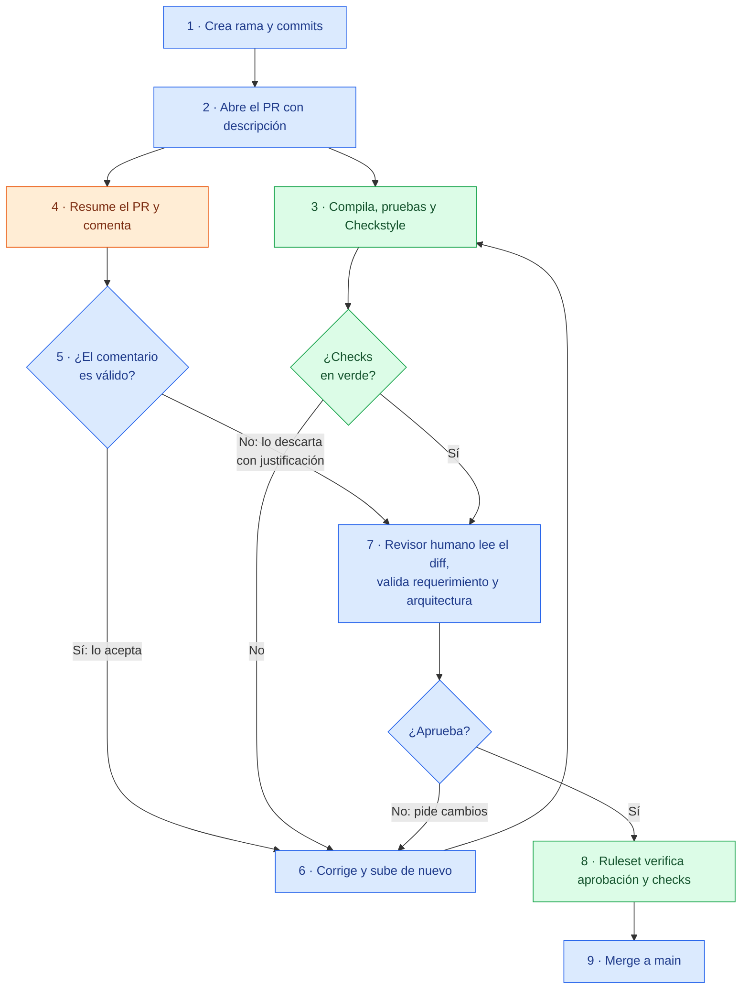

# Code reviews y pull requests con IA

- **Curso:** IF-6100 Análisis y Diseño de Sistemas · II Ciclo 2026
- **Tema:** 3. Code reviews y pull requests con IA
- **Integrantes:** [Nombre 1] · Jared Morales Morales · Adrián Barboza Vargas
- **Repositorio de la demostración:** https://github.com/jaredCR10/code-reviews-y-pull-requests-con-ia-demo

---

## 1. Glosario
<!-- Responsable: [Nombre 1] · Cada término con palabras propias, relación con el tema y referencia [n] -->

| Término | Definición | Fuente |
|---|---|---|
| Pull request | | |
| Code review | | |
| Revisor automático con IA | | |
| CI/CD | | |
| Branch protection | | |
| Status check | | |
| Linter / análisis estático | | |
| Falso positivo / falso negativo | | |
| Rubber-stamping | | |

## 2. Punto de partida del análisis
<!-- Responsable: [Nombre 1] · Preguntas iniciales, primeras fuentes y decisiones de alcance -->

## 3. Importancia de la revisión de código y el pull request como artefacto
<!-- Responsable: [Nombre 1] · Objetivos de la revisión; descripción, plantilla, tamaño y criterios de aceptación del PR -->

## 4. Herramientas utilizadas y su contexto
<!-- Responsable: Jared Morales -->

El objetivo no fue comparar herramientas, sino armar un flujo donde cada una cumple un papel distinto dentro de la revisión. Se eligieron herramientas que el equipo ya usaba (GitHub) o que tienen un plan gratuito suficiente para un repositorio público, que es una condición del trabajo.

### 4.1 GitHub (pull requests y rulesets)
- **Tipo:** plataforma de control de versiones.
- **Papel:** aloja el repositorio y el PR, que es el artefacto donde ocurre la revisión. Sus *rulesets* bloquean el merge si no se cumplen las reglas.
- **Modalidad:** cuenta gratuita, repositorio público.
- **Limitaciones:** no permite aprobar el propio PR, así que la regla de aprobación exige a otro integrante. Al crear el ruleset hay que indicar la rama objetivo; si no, la regla existe pero no se aplica.

### 4.2 GitHub Actions
- **Tipo:** integración continua (CI).
- **Papel:** compila, ejecuta pruebas y verifica estándares en cada PR. Sus resultados son los *status checks* obligatorios (detalle en la sección 5).
- **Modalidad:** minutos ilimitados en repositorios públicos.
- **Limitaciones:** los registros advierten que `checkout@v4`, `setup-node@v4` y `setup-java@v4` usan Node 20, que está obsoleto en los *runners*, y que `setup-java@v4` ya no recibirá actualizaciones (se recomienda migrar a `setup-java@v5`).

### 4.3 Checkstyle y Vitest
- **Tipo:** análisis estático (Checkstyle, para Java) y pruebas unitarias (Vitest, para Angular).
- **Papel:** el CI los ejecuta para verificar el estándar de código del backend y las pruebas del frontend.
- **Modalidad:** software libre.
- **Limitaciones:** en Checkstyle se usó un conjunto reducido de reglas para no obligar a reescribir el código existente; no revisa lógica ni arquitectura. El frontend no tenía ESLint configurado, así que el estándar de TypeScript todavía no se verifica (trabajo pendiente).

### 4.4 CodeRabbit
- **Tipo:** revisor automático con IA.
- **Papel:** resume el PR, deja comentarios línea por línea y responde cuando se le menciona con `@coderabbitai`. Recibe como contexto los lineamientos de diseño del proyecto.
- **Modalidad:** acceso gratuito para proyectos open source (repositorios públicos). En la información de la revisión aparece como plan *Advanced*. Durante la prueba, el límite observado fue de 10 revisiones por hora; según la documentación, ese límite varía en los proyectos open source, y el plan *Free* para repositorios privados solo genera resúmenes de PR.
- **Limitaciones:** no revisó automáticamente un PR que ya estaba abierto antes de instalarlo, y su aviso señalaba otra causa. Marcó como "Major" un comentario que era una preferencia, no un error.

### 4.5 Claude (asistente de apoyo)
- **Tipo:** asistente de IA, plan Pro de un integrante. **No es gratuito; se declara por transparencia.**
- **Papel:** se usó para **preparar** la infraestructura (redactar el workflow y la configuración, y abrir los PRs de configuración). **No forma parte del flujo demostrado**, que se puede reproducir sin él.
- **Limitaciones:** cometió un error de configuración (el alcance de los lineamientos en CodeRabbit) que luego detectó el revisor de IA (ver 6.3, paso 5).

**Por qué un repositorio aparte.** Se trabajó sobre una copia pública del proyecto del curso (TallerAuto), en el repositorio `code-reviews-y-pull-requests-con-ia-demo`. Así se usa código real sin afectar el repositorio del curso, que es privado y pertenece a la organización del curso. Además, CodeRabbit solo hace revisiones completas gratuitas en repositorios públicos (acceso open source).

## 5. Participación del CI/CD en la revisión
<!-- Responsable: Jared Morales -->

En este flujo el CI funciona como un **revisor automático que no opina, sino que verifica**. Antes de que una persona lea el código, GitHub Actions ejecuta el workflow [`.github/workflows/ci.yml`](https://github.com/jaredCR10/code-reviews-y-pull-requests-con-ia-demo/blob/main/.github/workflows/ci.yml) en cada PR hacia `main`, con dos *jobs* en paralelo:

| Job | Paso | Comando |
|---|---|---|
| `backend` | Estándar de código Java | `./mvnw checkstyle:check` |
| `backend` | Compilación y pruebas (con H2 en memoria, sin MySQL) | `./mvnw verify` |
| `frontend` | Instalar dependencias | `npm ci` |
| `frontend` | Compilación | `npm run build` |
| `frontend` | Pruebas (Vitest) | `npm test -- --watch=false` |

**Reglas que bloquean la integración.** En `main` se configuró un *ruleset* de GitHub con 4 reglas (la primera tiene dos opciones):

| Regla | Efecto |
|---|---|
| Exigir pull request | Nadie puede hacer push directo a `main`, ni siquiera el administrador. Incluye dos opciones: |
| ↳ *opción:* 1 aprobación | Otra persona, distinta del autor, debe aprobar |
| ↳ *opción:* descartar aprobaciones viejas | Si el autor sube commits después de una aprobación, esta se anula y hay que revisar de nuevo. Evita que entre código que nadie leyó |
| *Status checks* obligatorios: `backend` y `frontend` | No se puede hacer merge si alguno falla |
| Bloquear borrado y *force push* | Protege el historial de `main` |

Se verificó que las reglas funcionan intentando un push directo a `main`: GitHub lo rechazó con el error `GH013: Repository rule violations`, indicando que los cambios deben entrar por PR y que faltan los 2 checks obligatorios (ver [`evidencia/`](evidencia/README.md)).

**Tiempo del CI.** En las 6 ejecuciones registradas, cada *job* tardó entre 17 y 46 segundos. El CI da retroalimentación casi inmediata, mucho antes de que un revisor humano abra el PR.

## 6. Proceso aplicado en la prueba
<!-- Responsable: Jared Morales -->

**Repositorio:** https://github.com/jaredCR10/code-reviews-y-pull-requests-con-ia-demo

### 6.1 Diagrama del flujo

🟦 Ingeniero · 🟧 IA (CodeRabbit) · 🟩 CI y reglas de GitHub. Los números coinciden con los pasos de la tabla 6.2.

### 6.2 División de labores

| Paso | Labor | Responsable | Punto de verificación del ingeniero |
|---|---|---|---|
| 1 | Crear una rama para el cambio y hacer los commits | Ingeniero (autor) | — |
| 2 | Abrir el PR con descripción: qué cambia, por qué y cómo se probó | Ingeniero (autor) | — |
| 3 | Compilar, ejecutar pruebas y verificar estándares | CI | El autor revisa el resultado de los checks |
| 4 | Resumir el PR y comentar posibles problemas | IA (CodeRabbit) | — |
| 5 | Evaluar cada comentario de la IA: **aceptar** (y corregir) o **descartar** con justificación | Ingeniero (autor) | ✅ **Verifica** cada comentario contra el código y la documentación; no acepta nada sin comprobarlo |
| 6 | Corregir lo aceptado y volver a subir | Ingeniero (autor) | El CI y la IA revisan de nuevo |
| 7 | Leer el diff completo, validar el requerimiento y la arquitectura | Ingeniero (revisor, otra persona) | ✅ **Aprueba** o pide cambios |
| 8 | Bloquear el merge si falta la aprobación o un check | GitHub (ruleset) | — |
| 9 | Hacer el merge a `main` | Ingeniero | ✅ Decisión final humana |

**Regla central:** la IA comenta, el CI verifica y **solo un humano aprueba**. Por eso CodeRabbit quedó configurado con `request_changes_workflow: false`: no puede aprobar ni bloquear un PR.

### 6.3 Paso a paso

Las capturas citadas como *(Evidencia NN)* están en [`evidencia/`](evidencia/README.md). Horas en tiempo de Costa Rica (UTC−6), 31 de octubre y 1 de noviembre de 2026.

**Preparación del entorno (antes de activar la protección).** Estos commits se hicieron directo a `main` porque el repositorio estaba vacío y todavía no había reglas:

1. **Copia del proyecto.** Se creó el repositorio público y se copió el código del proyecto TallerAuto sin su historial (commit [`d88c79d`](https://github.com/jaredCR10/code-reviews-y-pull-requests-con-ia-demo/commit/d88c79d)). Antes de publicarlo se revisó que la configuración no tuviera credenciales reales: solo contiene contraseñas de desarrollo local, y el archivo `.env` está en `.gitignore`.
2. **Estructura de la entrega.** Se agregó la carpeta `investigacion/` (commit [`fd55198`](https://github.com/jaredCR10/code-reviews-y-pull-requests-con-ia-demo/commit/fd55198)).

**PR #1: agregar el CI y el revisor de IA** ([enlace](https://github.com/jaredCR10/code-reviews-y-pull-requests-con-ia-demo/pull/1)), rama `ci/pipeline-revision`.

3. **Apertura (13:54).** Se abrió el PR con el workflow, Checkstyle y `.coderabbit.yaml`. Las instrucciones para la IA se tomaron de los lineamientos del propio proyecto (`docs/05-diseno/lineamientos-*.md`), por ejemplo: un controlador nunca accede a un repositorio y en Angular está prohibido el tipo `any`.
4. **El CI detecta un error que ya existía.** El job `backend` pasó, pero `frontend` falló ([ejecución](https://github.com/jaredCR10/code-reviews-y-pull-requests-con-ia-demo/actions/runs/41344091941)). La causa no estaba en el PR: la prueba `app.spec.ts`, generada por Angular, esperaba el título `"Hello, frontend"`, pero el equipo lo había cambiado a `"TallerAuto"` sin actualizar la prueba. Como nadie corría las pruebas de forma automática, el error había pasado desapercibido. *(Evidencia 01)*
5. **Revisión de la IA.** CodeRabbit no revisó el PR de forma automática porque se instaló cuando el PR ya estaba abierto. El ingeniero lo solicitó con el comando `@coderabbitai review`. La IA generó un resumen, una evaluación de seguridad (riesgo bajo) y 3 comentarios:

   | Comentario de la IA | Verificación del ingeniero | Decisión |
   |---|---|---|
   | Configurar `auto_pause_after_reviewed_commits: 0` para que nunca pause las revisiones ([enlace](https://github.com/jaredCR10/code-reviews-y-pull-requests-con-ia-demo/pull/1#discussion_r4437184345)) | Es cierto según la documentación, pero la misma documentación advierte que gasta la cuota más rápido. Nuestros PRs tienen pocos commits | **Descartado** con justificación. La IA respondió que retiraba la recomendación y marcó la conversación como resuelta *(Evidencia 02)* |
   | Los lineamientos de `docs/` no se aplican al código de `backend/` y `frontend/` ([enlace](https://github.com/jaredCR10/code-reviews-y-pull-requests-con-ia-demo/pull/1#discussion_r4437184352)) | Correcto: según la documentación, por defecto un archivo de lineamientos solo aplica a su propia carpeta; para usarlo en otras rutas hay que indicarlas con `applyTo`. El error venía de la configuración preparada con ayuda de Claude | **Aceptado**, corregido en el mismo PR (commit [`c19c365`](https://github.com/jaredCR10/code-reviews-y-pull-requests-con-ia-demo/commit/c19c365)) |
   | Corregir la prueba del frontend ([enlace](https://github.com/jaredCR10/code-reviews-y-pull-requests-con-ia-demo/pull/1#discussion_r4437184358)) | Correcto, coincide con lo que detectó el CI | **Aceptado**, pero en un PR aparte para mantener cada PR con un solo propósito *(Evidencia 06)* |

6. **Revisión humana y merge (15:25).** Otro integrante (Jose01R) aprobó el PR y se hizo el merge. Todavía no había protección de rama, por eso se pudo integrar con el job `frontend` en rojo. La decisión quedó documentada en el PR. *(Evidencia 07)*

**PR #2: corregir la prueba** ([enlace](https://github.com/jaredCR10/code-reviews-y-pull-requests-con-ia-demo/pull/2)), rama `fix/prueba-titulo-app`.

7. **Apertura (15:26).** Cambio de una sola línea en `app.spec.ts`.
8. **Todo en verde.** `backend` y `frontend` pasaron ([ejecución](https://github.com/jaredCR10/code-reviews-y-pull-requests-con-ia-demo/actions/runs/41352052900)). Esta vez CodeRabbit revisó automáticamente: publicó su resumen, pero no dejó comentarios accionables. *(Evidencias 03 y 04)*
9. **Aprobación y merge (15:50).** Aprobado por Jose01R. *(Evidencia 08)*

**Activación de la protección.**

10. Se creó el ruleset de `main` descrito en la sección 5 y se comprobó con un push directo, que fue rechazado (`GH013`). Desde ese momento, todo cambio entra por PR. *(Evidencias 05 y 09)*

**Cómo reproducirlo.** Cualquier persona puede repetir el flujo:

1. Crear un repositorio público en GitHub con el código del proyecto.
2. Copiar `.github/workflows/ci.yml`, `.coderabbit.yaml`, `backend/config/checkstyle/checkstyle.xml` y el plugin de Checkstyle del `backend/pom.xml` de este repositorio.
3. Instalar la aplicación de CodeRabbit en GitHub (coderabbit.ai) para ese repositorio. Conviene hacerlo **antes** de abrir PRs.
4. En *Settings → Rules → Rulesets*, crear la regla para la rama por defecto con las opciones de la sección 5. No olvidar agregar la rama objetivo y dejarla en estado *Active*.
5. Crear una rama, hacer un cambio, abrir el PR y seguir los pasos de la tabla 6.2.

## 7. Responsabilidades del revisor humano y del revisor de IA
<!-- Responsable: [Nombre 1] · Matriz de responsabilidades; cómo evitar aprobar sin leer -->

## 8. Comunicación y resolución de conflictos en revisiones
<!-- Responsable: [Nombre 1] -->

## 9. Hallazgos
<!-- Responsable: Adrián Barboza Vargas -->

### 9.1 Diseño del experimento

Para medir qué detecta cada revisor se abrió un PR con errores conocidos de antemano: el [PR #7](https://github.com/jaredCR10/code-reviews-y-pull-requests-con-ia-demo/pull/7), rama `feature/cu13-registrar-ingreso-insumos`. El PR implementa un caso de uso real del proyecto, **CU-13 Registrar Ingreso de Insumos** (RF-03), con controlador, DTO, *handler* CQRS y pruebas. En él se plantaron seis defectos, uno por cada categoría del plan. La lista de defectos se guardó aparte, fuera del repositorio, y no se compartió con el revisor humano.

Para no sesgar la medición:
- el código no tiene comentarios que delaten los errores;
- la descripción del PR sigue la plantilla con un texto realista;
- los criterios de aceptación remiten al caso de uso sin repetir sus reglas, porque CodeRabbit también lee la descripción.

| # | Defecto plantado | Dónde |
|---|---|---|
| 1 | Violación de estilo: `import java.util.List` sin usar | `InsumoController.java`, línea 9 |
| 2 | Prueba que falla: la prueba espera "mayor **que** cero" y el *handler* devuelve "mayor **a** cero" | `RegistrarIngresoInsumoHandlerImplTest` |
| 3 | Credencial quemada: token de administrador escrito en el código | `InsumoController.java`, línea 25 |
| 4 | Caso borde / *null*: `Integer cantidad` sin `@NotNull`, lo que provoca `NullPointerException` al convertirlo a `int` | `RegistrarIngresoInsumoRequest.java` |
| 5 | Regla de negocio: `cantidad < 0` acepta 0, pero CU-13 (FA-02, escenario E3) exige un entero mayor que cero | `RegistrarIngresoInsumoHandlerImpl.java`, línea 27 |
| 6 | Arquitectura en capas: el controlador usa `InsumoRepository` directamente, saltándose la capa de *handlers* | `InsumoController.java`, línea 50 |

### 9.2 Resultados

| Defecto plantado | ¿Lo detectó el CI? | ¿Lo detectó la IA? | ¿Lo detectó el humano? | Evidencia |
|---|---|---|---|---|
| 1. Violación de estilo | **Sí**: Checkstyle, `UnusedImports` (16 s) | Sí (Major), citando el fallo del CI | Sí | p3-01, p3-03, p3-14 |
| 2. Prueba que falla | **No** en la primera ejecución: el paso de pruebas se omitió porque Checkstyle falló antes. **Sí** en la segunda, después de corregir el #1 (`rechazaUnaCantidadNegativa`, ~40 s después del commit) | Sí (Major), por análisis estático del código, antes que el CI | Sí, y propone la corrección alineada con CU-13 (cambiar el mensaje, no la prueba) | p3-01, p3-04, p3-13, p3-14 |
| 3. Credencial en el código | No: el CI no tiene escáner de secretos | Sí (Major, Security, CWE-798) | Sí, y agrega que según RS-01 el control de rol va en el paquete `security` | p3-05, p3-15 |
| 4. Null pointer / caso borde | No | Sí (Minor) | Sí, y propone `@NotNull` y `@Positive` para validar en el borde | p3-06, p3-16 |
| 5. Regla de negocio incumplida | No | Sí (Minor), pero basándose en el mensaje del código, no en el CU; lo **confirmó la propia IA** al preguntarle (ver 9.3) | **Sí, citando CU-13** | p3-07, p3-16, p3-18 |
| 6. Violación de arquitectura en capas | No | Sí (Major), citando los lineamientos del proyecto | Sí, y propone un `Result.NoEncontrado` en el *handler* | p3-08, p3-17 |

**Conteo final:** CI 1/6 en la primera ejecución (2/6 contando la segunda) · IA 6/6 · humano 6/6.

Además de los seis defectos, CodeRabbit dejó **dos comentarios extra** (el revisor humano no hizo comentarios fuera de los defectos plantados):
- **Incrementos concurrentes** (*lost update*), clasificado como Major. Es un riesgo real, pero queda fuera del alcance del caso de uso y del curso. *(p3-09)*
- **Desbordamiento de `existencia`** con `Integer.MAX_VALUE`, clasificado como Minor. Se **rechazó como falso positivo** en el hilo del PR: el escenario no es realista para el inventario de un taller y la tabla ya protege la regla con `CHECK (existencia >= 0)`. *(p3-10, p3-12)*

**Tiempos** (4/11/2026, hora de Costa Rica):

| Revisor | Momento | Tiempo desde la apertura (00:47:50) |
|---|---|---|
| CI | Terminó la primera ejecución (detecta el #1) | ~30 s (backend 16 s, frontend 27 s) |
| CI | Segunda ejecución, tras corregir el #1 (detecta el #2) | 11 h 32 min después de la apertura; ~40 s después del commit de corrección (12:19:31 → 12:20:09) |
| IA | Publicó el resumen del PR | 19 s |
| IA | Publicó 8 comentarios línea por línea | ~5 min 10 s |
| Humano | Publicó su revisión ("Request changes", 6 comentarios) | 12:49:06, unas 12 h después de la apertura; el tiempo efectivo de lectura lo reporta José |

### 9.3 Qué funcionó y qué falló

**Lo que funcionó**
- **El CI** fue rápido y determinista. El primer defecto que encontró (#1) bloqueó el *merge* sin intervención humana.
- **La IA** comentó los seis defectos, con explicación y propuesta de corrección. Clasificó el token quemado como vulnerabilidad (CWE-798) y citó los lineamientos del equipo para la violación de capas. Configurarle esos lineamientos como contexto (`knowledge_base` en `.coderabbit.yaml`) fue decisivo.
- **El flujo de aceptar y rechazar** funcionó como se esperaba. La sugerencia del import se verificó contra el resultado del CI y se aceptó con un commit. La del desbordamiento se rechazó con una justificación técnica. *(p3-11, p3-12)*

**Lo que falló o hay que matizar**
- **El CI descubre los defectos en serie.** En el job `backend`, Checkstyle corre antes que las pruebas: como falló el estilo, la prueba rota (#2) ni siquiera se ejecutó. Se comprobó en la práctica: al corregir el #1 (commit `519885d`), la segunda ejecución sí reportó la prueba fallida. *(p3-13)*
- **La IA no es independiente del CI.** En el defecto #1, CodeRabbit cita como fuente "Pipeline failures": leyó el resultado del CI. Parte de su "detección" es reutilizar lo que ya había encontrado otra herramienta.
- **La detección del #5 no prueba que la IA conozca la regla de negocio.** La IA no recibió los casos de uso como contexto, solo los lineamientos. Al preguntarle con `@coderabbitai` en qué se basó, respondió que su justificación fue **el mensaje de validación del código** («mayor a cero»), que no citó CU-13 y que no puede confirmar haberlo consultado. Solo después de la pregunta revisó CU-13 y reconoció que su comentario debió fundamentarse en FA-02 y E3. *(p3-18)* El revisor humano, en cambio, citó CU-13 desde el principio. Es la diferencia más clara del experimento: **los dos llegaron al mismo hallazgo, pero solo el humano lo validó contra el requerimiento**.
- **El revisor humano aportó más que la detección.** Además de encontrar los seis defectos, propuso correcciones basadas en el diseño del proyecto: el control de rol en el paquete `security` (RS-01), `@Positive` para validar en el borde y un `Result.NoEncontrado` para el flujo alternativo FA-01. Tampoco generó ruido: no hizo comentarios fuera de los defectos plantados.
- **Severidad poco confiable.** La IA marcó como Major un import sin usar, y como Minor la regla de negocio, que es el error con más impacto funcional.

### 9.4 Errores de la IA y riesgos
- **Falso positivo:** el desbordamiento de `Integer.MAX_VALUE` es técnicamente posible pero irrelevante para el dominio. Aceptarlo sin pensar habría agregado complejidad sin beneficio.
- **Ruido:** 2 de 8 comentarios no correspondían a ningún defecto plantado. En PRs grandes, ese ruido aumenta el riesgo de que el revisor deje de leer.
- **Sesgos a favor de la IA en este experimento:**
  1. `.coderabbit.yaml` le pide explícitamente buscar credenciales, `NullPointerException` y violaciones de capas (defectos #3, #4 y #6).
  2. El defecto #5 contenía una pista interna.
- **Sesgos del revisor humano:**
  1. José preparó con anticipación una guía de revisión a partir de los lineamientos.
  2. Revisó unas 12 horas después de la revisión de CodeRabbit, con los comentarios de la IA visibles en el PR, salvo que los ocultara. No se puede descartar que lo hayan influido. Sin embargo, sus comentarios citan fuentes que la IA no citó (CU-13, RS-01) y proponen correcciones distintas.
- **Riesgo de *rubber-stamping*:** con el CI en rojo y 8 comentarios de la IA bien redactados, es tentador aceptar todo sin verificar. La regla del equipo (verificar antes de aceptar, justificar al rechazar) es la barrera.

## 10. Conclusiones y recomendaciones para el proyecto del curso
<!-- Responsable: Adrián Barboza Vargas -->

**Conclusiones**
1. **Cada revisor cubre un tipo distinto de error, y ninguno basta solo.** En el experimento, la IA y el humano detectaron los seis defectos y el CI uno (dos al corregir el primero), pero no por las mismas razones. El CI es rápido e indiscutible para lo que se puede verificar mecánicamente (estilo y pruebas). La IA aporta en seguridad, casos borde y consistencia con los lineamientos. El humano es el único que puede validar contra el caso de uso y responder por el *merge*.
2. **La calidad de la revisión de la IA depende del contexto que se le configure.** Sin los lineamientos en `.coderabbit.yaml`, la violación de capas probablemente no se habría señalado con esa precisión.
3. **Que la IA detecte algo no significa que entienda el negocio.** La propia IA reconoció que detectó el defecto #5 por el mensaje del código y no por CU-13. El humano lo validó contra el caso de uso. La verificación contra los requerimientos sigue siendo humana.
4. **La aprobación debe seguir siendo humana.** Un falso positivo y una escala de severidad discutible muestran que aceptar las sugerencias de la IA sin verificarlas introduce cambios innecesarios.
5. **Conversar con la IA sirve para auditarla.** Preguntarle a `@coderabbitai` en qué se basó reveló el origen real de su comentario. Esa pregunta debería ser parte del flujo cuando un comentario de la IA toca reglas de negocio.

**Recomendaciones para TallerAuto**
1. **Adoptar el flujo completo en el repositorio del curso:** PR con plantilla, CI obligatorio, *ruleset* en `main` y aprobación humana. Todo funciona en el plan gratuito con repositorio público. Si el repositorio sigue privado, CodeRabbit solo genera resúmenes, así que la IA perdería la revisión línea por línea.
2. **Mostrar todos los fallos del CI en una sola ejecución:** agregar `if: ${{ !cancelled() }}` al paso de pruebas, para que el autor vea juntos los errores de estilo y los de pruebas.
3. **Agregar ESLint al frontend y un escáner de secretos** (por ejemplo, GitHub *secret scanning* o Gitleaks en el workflow). Así el CI cubriría el estilo de TypeScript y las credenciales quemadas sin depender de la IA.
4. **Darle a la IA los casos de uso como contexto,** además de los lineamientos (`knowledge_base` con `docs/03-casos-de-uso/**`), y medir de nuevo si detecta reglas de negocio sin pistas en el código.
5. **Alinear los lineamientos con Checkstyle:** los lineamientos dicen 120 caracteres por línea y prohíben los números mágicos, pero Checkstyle permite 140 y no tiene la regla `MagicNumber`.
6. **Mantener la regla de revisión:** el revisor humano lee el *diff* y valida contra el CU antes de mirar los comentarios de la IA, y cada sugerencia de la IA se acepta solo después de verificarla o se rechaza con justificación en el hilo.

## 11. Referencias
<!-- Todos · Formato consistente (APA) -->

<!-- Referencias de las secciones 4, 5 y 6 (Jared). Los demás agregan las suyas y al final se ordenan alfabéticamente. -->

- CodeRabbit. (2026). *Automatic reviews*. https://docs.coderabbit.ai/configuration/auto-review
- CodeRabbit. (2026). *Code guidelines*. https://docs.coderabbit.ai/knowledge-base/code-guidelines
- CodeRabbit. (2026). *Plans*. https://docs.coderabbit.ai/management/plans
- GitHub. (2026). *About rulesets*. https://docs.github.com/en/repositories/configuring-branches-and-merges-in-your-repository/managing-rulesets/about-rulesets
- GitHub. (2026). *About status checks*. https://docs.github.com/en/pull-requests/collaborating-with-pull-requests/collaborating-on-repositories-with-code-quality-features/about-status-checks
- GitHub. (2026). *GitHub Actions documentation*. https://docs.github.com/en/actions
- Checkstyle. (2026). *Checkstyle*. https://checkstyle.org
