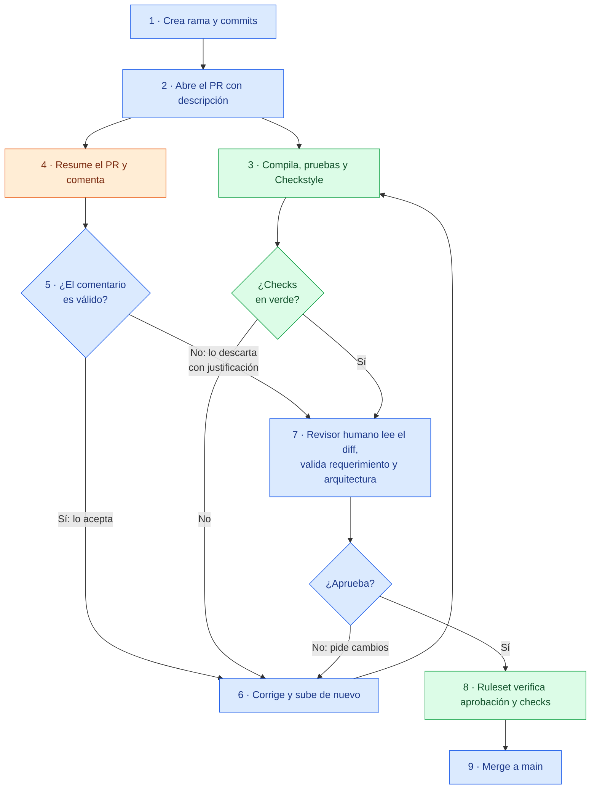

# Code reviews y pull requests con IA

- **Curso:** IF-6100 Análisis y Diseño de Sistemas · II Ciclo 2026
- **Tema:** 3. Code reviews y pull requests con IA
- **Integrantes:** José Andrés Ramírez Jiménez · Jared Morales Morales · Adrián Barboza Vargas
- **Repositorio de la demostración:** https://github.com/jaredCR10/code-reviews-y-pull-requests-con-ia-demo

---

## 1. Glosario
<!-- Responsable: [Nombre 1] · Cada término con palabras propias, relación con el tema y referencia [n] -->

| Término | Definición | Fuente |
|---|---|---|
| Pull request (PR) | Solicitud para incorporar los cambios de una rama en otra (normalmente `main`). Reúne el *diff*, la descripción, la discusión, los *checks* automáticos y las aprobaciones; es el punto donde se decide si el código se integra. | GitHub, *About pull requests* |
| Code review | Revisión del código de un cambio por una o más personas distintas de quien lo escribió, para detectar errores, mejorar el diseño y compartir conocimiento antes de integrarlo. | Google (s. f.) |
| Merge | Integración de los cambios de la rama del PR en la rama destino (*merge commit*, *squash* o *rebase*). A partir de la activación del *ruleset* en `main`, solo ocurre con los *checks* en verde y aprobación humana (los PR previos a esa activación se integraron sin esa restricción; ver sección 6.3). | GitHub, *About pull request merges* |
| Diff | Diferencias línea por línea entre el código antes y después del cambio; es lo que realmente se revisa en un PR. | GitHub, *About pull request merges* |
| Rama (branch) | Línea de trabajo independiente que parte de un punto del repositorio y permite desarrollar un cambio sin afectar `main` hasta fusionarlo. | GitHub, *About pull requests* |
| Branch protection | Reglas sobre una rama (p. ej. `main`) que impiden el *merge* directo y exigen condiciones como *checks* en verde y aprobaciones. En esta demostración se implementó con *rulesets* de GitHub (ver sección 5). | GitHub, *About rulesets* |
| Status check | Resultado (verde/rojo) que un *workflow* o integración publica sobre un commit o PR; cuando es obligatorio, su estado en verde condiciona el *merge*. | GitHub, *About status checks* |
| CI/CD | Integración y validación automáticas y frecuentes de los cambios (CI) y automatización de su publicación o despliegue (CD). La demostración usa la parte de CI. | Fowler (2024) |
| GitHub Actions | Servicio de automatización de GitHub que ejecuta *workflows* (definidos en YAML) ante eventos del repositorio, como abrir o actualizar un PR. | GitHub, *GitHub Actions* |
| Workflow / pipeline | Secuencia automatizada de pasos (compilar, probar, analizar) disparada por un evento. En GitHub se implementa como *workflow*. | GitHub, *GitHub Actions* |
| Linter / análisis estático | Herramienta que examina el código sin ejecutarlo para detectar errores, malas prácticas y violaciones de estilo. En esta demostración se usa Checkstyle (Java); el estándar de TypeScript del frontend aún no se verifica (ESLint pendiente, ver sección 4.3). | Checkstyle (2026) |
| CODEOWNERS | Archivo (`.github/CODEOWNERS`) que define quién es dueño de cada parte del repositorio; GitHub solicita su revisión cuando un PR toca sus archivos. | GitHub, *About code owners* |
| Code Owner | Persona o equipo responsable de revisar los archivos que le corresponden; con la regla *Require review from Code Owners*, su aprobación es obligatoria. | GitHub, *About code owners* |
| LLM (modelo grande de lenguaje) | Modelo entrenado con grandes cantidades de texto que predice y genera lenguaje natural; es el motor del revisor de IA, que lo usa para "entender" el *diff* y redactar sus comentarios. | IBM, *What are large language models (LLMs)?* |
| Agente de IA | Programa que usa un LLM para planear y ejecutar una tarea por su cuenta, encadenando pasos y usando herramientas. Un revisor como CodeRabbit actúa como agente: lee el *diff*, consulta los lineamientos y responde en el hilo. | IBM, *What are AI agents?* |
| Prompt | Instrucción o entrada que se le da al modelo para obtener una respuesta. En la revisión, el *prompt* combina las reglas configuradas en `.coderabbit.yaml` con el *diff* del PR. | OpenAI, *Prompt engineering* |
| Contexto (ventana de contexto) | Información que el modelo tiene presente al responder (el *diff*, los lineamientos, el hilo del PR); lo que queda fuera de esa ventana no lo considera. Por eso pasarle los lineamientos como contexto mejora la revisión. | IBM, *What is a context window?* |
| Alucinación | Respuesta del modelo que suena convincente pero es incorrecta o inventada. En una revisión aparece como un comentario sobre un problema inexistente (falso positivo); es la razón por la que toda sugerencia de la IA debe verificarse. | IBM, *What are AI hallucinations?* |
| Revisor automático con IA | Herramienta basada en modelos de lenguaje que analiza el *diff* del PR y produce un resumen y comentarios (posibles errores, estilo, riesgos). En esta demostración: CodeRabbit. No sustituye al revisor humano. | CodeRabbit (2026) |
| Rubber-stamping | Aprobar un PR sin revisarlo de verdad. Es el principal riesgo de calidad que una revisión seria debe evitar. | Google (s. f.); SmartBear (s. f.) |
| Falso positivo / falso negativo | *Falso positivo*: marcar como problema algo que no lo es. *Falso negativo*: no detectar un problema que sí existe. Ambos importan al evaluar un linter o un revisor de IA. | Perforce (s. f.) |
| Criterios de aceptación | Condiciones concretas y verificables que un cambio debe cumplir para considerarse terminado y aprobable; derivan del caso de uso o requerimiento. | Atlassian (s. f.) |
| Arquitectura por capas | Organización del código en capas con responsabilidades separadas (API, lógica/dominio, persistencia). La revisión verifica que el cambio respete esa separación. | Richards (2015) |
| Secreto quemado (hardcoded secret) | Credencial, contraseña o llave de API escrita directamente en el código fuente. Mala práctica de seguridad que debe detectarse antes del *merge*. | OWASP (s. f.) |

## 2. Punto de partida del análisis
<!-- Responsable: [Nombre 1] · Preguntas iniciales, primeras fuentes y decisiones de alcance -->

El análisis arrancó con cuatro preguntas que guiaron toda la investigación:

- ¿Qué es realmente una revisión de código y para qué sirve, más allá de "buscar errores"?
- ¿Qué aporta y qué **no** aporta una IA en la revisión, y dónde sigue siendo imprescindible el criterio humano?
- ¿Cómo se ve un flujo de *pull request* completo y realista: plantilla, CI, linters, revisor de IA, aprobación humana y protección de rama?
- ¿Cómo medir todo esto de forma honesta? De esta última pregunta nació la idea de un PR con errores sembrados y una tabla que compara qué detecta cada actor (CI, IA, humano).

Las primeras fuentes consultadas fueron la documentación oficial de GitHub (pull requests, *rulesets*, CODEOWNERS y Actions), la documentación de CodeRabbit y la guía de prácticas de ingeniería de Google como marco conceptual de la revisión de código (Google, s. f.).

El alcance se acotó con tres decisiones:

1. **No es una comparación de herramientas**, sino un flujo mostrado de principio a fin con una combinación concreta de herramientas y su justificación (ver sección 4).
2. Se trabajó sobre una **copia pública de un proyecto real** (TallerAuto, un sistema para un taller automotriz) en lugar de ejemplos de juguete, para que los PR tocaran código, pruebas y arquitectura verdaderos.
3. La medición se limitó a **seis errores sembrados** de categorías distintas (violación de estilo, prueba que falla, secreto quemado, caso borde/null, regla de negocio incumplida y violación de la arquitectura en capas), para comparar qué detecta el CI, la IA y el revisor humano (ver sección 9).

El trabajo se dividió en tres partes: Fundamentos (secciones 1–3, 7 y 8), Infraestructura y flujo (secciones 4–6) y PR sembrado y hallazgos (secciones 9–10).

## 3. Importancia de la revisión de código y el pull request como artefacto
<!-- Responsable: [Nombre 1] · Objetivos de la revisión; descripción, plantilla, tamaño y criterios de aceptación del PR -->

### 3.1 Por qué importa revisar el código

La revisión de código es el último filtro humano antes de que un cambio entre a `main`. No sustituye a las pruebas automatizadas ni a los linters: las complementa con algo que esas herramientas no dan, que es **juicio**. Una prueba indica si el código hace lo que la prueba espera; un revisor indica si el código hace lo **correcto**, si está bien diseñado y si otra persona podrá mantenerlo (Google, s. f.).

Los objetivos concretos de una revisión son:

1. **Correctitud:** que el cambio cumpla el requerimiento o caso de uso y maneje los casos borde.
2. **Diseño y arquitectura:** que respete la separación por capas y no introduzca deuda técnica (en TallerAuto, ver `docs/05-diseno/`) (Richards, 2015).
3. **Legibilidad y mantenibilidad:** que otra persona pueda entender y modificar el código después.
4. **Seguridad:** que no haya secretos quemados ni vulnerabilidades evidentes (OWASP, s. f.).
5. **Difusión de conocimiento:** que el equipo conozca el cambio y no quede en una sola persona.
6. **Cumplimiento de estándares:** estilo, convenciones y pruebas presentes.

La idea de fondo, siguiendo la guía de Google, es que revisar no busca encontrar culpables, sino que el código mejore y que más de una persona lo comprenda (Google, s. f.).

### 3.2 El pull request como artefacto

El PR no es solo "el botón de *merge*": es un **artefacto de ingeniería** que documenta qué cambió, por qué, cómo se validó y quién lo aprobó. En la demostración se estandarizó con una plantilla (`.github/pull_request_template.md`) que obliga a pensar antes de pedir revisión. Sus secciones y lo que aportan a la revisión son:

| Sección de la plantilla | Qué aporta a la revisión |
|---|---|
| Descripción | Contexto en dos o tres líneas: qué cambia y por qué. Evita que el revisor adivine. |
| Caso de uso / requerimiento | Liga el cambio a un CU o RF (p. ej. CU-01). Permite revisar contra el requerimiento, no contra el gusto. |
| Tipo de cambio | Clasifica (funcionalidad, corrección, refactor, documentación, infraestructura) y ajusta la profundidad de la revisión. |
| Criterios de aceptación | Lista verificable de lo que debe cumplirse para aprobar (Atlassian, s. f.). |
| Cómo se probó | Comandos y resultados (`./mvnw verify`, `npm run build`, `npm test`, prueba manual). Evidencia reproducible. |
| Tamaño del PR | Obliga a declarar el tamaño y a dividir si supera ~400 líneas. |
| Participación de la IA | Específico de esta investigación: declara si se usó IA para el código o para revisar. |
| Lista de verificación del autor | Autocontrol previo: un solo propósito, *diff* auto-revisado, CI en verde, capas respetadas, sin secretos. |
| Notas para quien revisa | Dirige la atención del revisor a lo importante. |

Como buenas prácticas, el PR debe ser **pequeño y enfocado** (un solo propósito): los PR grandes se revisan peor y esconden errores, y la evidencia de la industria recomienda revisar menos de 200 a 400 líneas por sesión, porque la capacidad de detección cae tras unos 60 minutos (SmartBear, s. f.). La descripción debe ser autosuficiente, los criterios de aceptación explícitos y la trazabilidad al CU/RF clara, de modo que el PR quede conectado con el análisis del sistema.

## 4. Herramientas utilizadas y su contexto
<!-- Responsable: Jared Morales -->

El objetivo no fue comparar herramientas, sino armar un flujo donde cada una cumple un papel distinto dentro de la revisión. Se eligieron herramientas que el equipo ya usaba (GitHub) o que tienen un plan gratuito suficiente para un repositorio público, que es una condición del trabajo.

### 4.1 GitHub (pull requests y rulesets)
- **Tipo:** plataforma de control de versiones.
- **Papel:** aloja el repositorio y el PR, que es el artefacto donde ocurre la revisión. Sus *rulesets* bloquean el merge si no se cumplen las reglas.
- **Modalidad:** cuenta gratuita, repositorio público.
- **Limitaciones:** no permite aprobar el propio PR, así que la regla de aprobación exige a otro integrante. Al crear el ruleset hay que indicar la rama objetivo; si no, la regla existe pero no se aplica.

### 4.2 GitHub Actions
- **Tipo:** integración continua (CI).
- **Papel:** compila, ejecuta pruebas y verifica estándares en cada PR. Sus resultados son los *status checks* obligatorios (detalle en la sección 5).
- **Modalidad:** minutos ilimitados en repositorios públicos.
- **Limitaciones:** los registros advierten que `checkout@v4`, `setup-node@v4` y `setup-java@v4` usan Node 20, que está obsoleto en los *runners*, y que `setup-java@v4` ya no recibirá actualizaciones (se recomienda migrar a `setup-java@v5`).

### 4.3 Checkstyle y Vitest
- **Tipo:** análisis estático (Checkstyle, para Java) y pruebas unitarias (Vitest, para Angular).
- **Papel:** el CI los ejecuta para verificar el estándar de código del backend y las pruebas del frontend.
- **Modalidad:** software libre.
- **Limitaciones:** en Checkstyle se usó un conjunto reducido de reglas para no obligar a reescribir el código existente; no revisa lógica ni arquitectura. El frontend no tenía ESLint configurado, así que el estándar de TypeScript todavía no se verifica (trabajo pendiente).

### 4.4 CodeRabbit
- **Tipo:** revisor automático con IA.
- **Papel:** resume el PR, deja comentarios línea por línea y responde cuando se le menciona con `@coderabbitai`. Recibe como contexto los lineamientos de diseño del proyecto.
- **Modalidad:** acceso gratuito para proyectos open source (repositorios públicos). En la información de la revisión aparece como plan *Advanced*. Durante la prueba, el límite observado fue de 10 revisiones por hora; según la documentación, ese límite varía en los proyectos open source, y el plan *Free* para repositorios privados solo genera resúmenes de PR.
- **Limitaciones:** no revisó automáticamente un PR que ya estaba abierto antes de instalarlo, y su aviso señalaba otra causa. Marcó como "Major" un comentario que era una preferencia, no un error.

### 4.5 Claude (asistente de apoyo)
- **Tipo:** asistente de IA, plan Pro de un integrante. **No es gratuito; se declara por transparencia.**
- **Papel:** se usó para **preparar** la infraestructura (redactar el workflow y la configuración, y abrir los PRs de configuración). **No forma parte del flujo demostrado**, que se puede reproducir sin él.
- **Limitaciones:** cometió un error de configuración (el alcance de los lineamientos en CodeRabbit) que luego detectó el revisor de IA (ver 6.3, paso 5).

**Por qué un repositorio aparte.** Se trabajó sobre una copia pública del proyecto del curso (TallerAuto), en el repositorio `code-reviews-y-pull-requests-con-ia-demo`. Así se usa código real sin afectar el repositorio del curso, que es privado y pertenece a la organización del curso. Además, CodeRabbit solo hace revisiones completas gratuitas en repositorios públicos (acceso open source).

## 5. Participación del CI/CD en la revisión
<!-- Responsable: Jared Morales -->

En este flujo el CI funciona como un **revisor automático que no opina, sino que verifica**. Antes de que una persona lea el código, GitHub Actions ejecuta el workflow [`.github/workflows/ci.yml`](https://github.com/jaredCR10/code-reviews-y-pull-requests-con-ia-demo/blob/main/.github/workflows/ci.yml) en cada PR hacia `main`, con dos *jobs* en paralelo:

| Job | Paso | Comando |
|---|---|---|
| `backend` | Estándar de código Java | `./mvnw checkstyle:check` |
| `backend` | Compilación y pruebas (con H2 en memoria, sin MySQL) | `./mvnw verify` |
| `frontend` | Instalar dependencias | `npm ci` |
| `frontend` | Compilación | `npm run build` |
| `frontend` | Pruebas (Vitest) | `npm test -- --watch=false` |

**Reglas que bloquean la integración.** En `main` se configuró un *ruleset* de GitHub con 4 reglas (la primera tiene dos opciones):

| Regla | Efecto |
|---|---|
| Exigir pull request | Nadie puede hacer push directo a `main`, ni siquiera el administrador. Incluye dos opciones: |
| ↳ *opción:* 1 aprobación | Otra persona, distinta del autor, debe aprobar |
| ↳ *opción:* descartar aprobaciones viejas | Si el autor sube commits después de una aprobación, esta se anula y hay que revisar de nuevo. Evita que entre código que nadie leyó |
| *Status checks* obligatorios: `backend` y `frontend` | No se puede hacer merge si alguno falla |
| Bloquear borrado y *force push* | Protege el historial de `main` |

Se verificó que las reglas funcionan intentando un push directo a `main`: GitHub lo rechazó con el error `GH013: Repository rule violations`, indicando que los cambios deben entrar por PR y que faltan los 2 checks obligatorios (ver [`evidencia/`](evidencia/README.md)).

**Tiempo del CI.** En las 6 ejecuciones registradas, cada *job* tardó entre 17 y 46 segundos. El CI da retroalimentación casi inmediata, mucho antes de que un revisor humano abra el PR.

## 6. Proceso aplicado en la prueba
<!-- Responsable: Jared Morales -->

**Repositorio:** https://github.com/jaredCR10/code-reviews-y-pull-requests-con-ia-demo

### 6.1 Diagrama del flujo

🟦 Ingeniero · 🟧 IA (CodeRabbit) · 🟩 CI y reglas de GitHub. Los números coinciden con los pasos de la tabla 6.2.

### 6.2 División de labores

| Paso | Labor | Responsable | Punto de verificación del ingeniero |
|---|---|---|---|
| 1 | Crear una rama para el cambio y hacer los commits | Ingeniero (autor) | — |
| 2 | Abrir el PR con descripción: qué cambia, por qué y cómo se probó | Ingeniero (autor) | — |
| 3 | Compilar, ejecutar pruebas y verificar estándares | CI | El autor revisa el resultado de los checks |
| 4 | Resumir el PR y comentar posibles problemas | IA (CodeRabbit) | — |
| 5 | Evaluar cada comentario de la IA: **aceptar** (y corregir) o **descartar** con justificación | Ingeniero (autor) | ✅ **Verifica** cada comentario contra el código y la documentación; no acepta nada sin comprobarlo |
| 6 | Corregir lo aceptado y volver a subir | Ingeniero (autor) | El CI y la IA revisan de nuevo |
| 7 | Leer el diff completo, validar el requerimiento y la arquitectura | Ingeniero (revisor, otra persona) | ✅ **Aprueba** o pide cambios |
| 8 | Bloquear el merge si falta la aprobación o un check | GitHub (ruleset) | — |
| 9 | Hacer el merge a `main` | Ingeniero | ✅ Decisión final humana |

**Regla central:** la IA comenta, el CI verifica y **solo un humano aprueba**. Por eso CodeRabbit quedó configurado con `request_changes_workflow: false`: no puede aprobar ni bloquear un PR.

### 6.3 Paso a paso

Las capturas citadas como *(Evidencia NN)* están en [`evidencia/`](evidencia/README.md). Horas en tiempo de Costa Rica (UTC−6), 31 de octubre y 1 de noviembre de 2026.

**Preparación del entorno (antes de activar la protección).** Estos commits se hicieron directo a `main` porque el repositorio estaba vacío y todavía no había reglas:

1. **Copia del proyecto.** Se creó el repositorio público y se copió el código del proyecto TallerAuto sin su historial (commit [`d88c79d`](https://github.com/jaredCR10/code-reviews-y-pull-requests-con-ia-demo/commit/d88c79d)). Antes de publicarlo se revisó que la configuración no tuviera credenciales reales: solo contiene contraseñas de desarrollo local, y el archivo `.env` está en `.gitignore`.
2. **Estructura de la entrega.** Se agregó la carpeta `investigacion/` (commit [`fd55198`](https://github.com/jaredCR10/code-reviews-y-pull-requests-con-ia-demo/commit/fd55198)).

**PR #1: agregar el CI y el revisor de IA** ([enlace](https://github.com/jaredCR10/code-reviews-y-pull-requests-con-ia-demo/pull/1)), rama `ci/pipeline-revision`.

3. **Apertura (13:54).** Se abrió el PR con el workflow, Checkstyle y `.coderabbit.yaml`. Las instrucciones para la IA se tomaron de los lineamientos del propio proyecto (`docs/05-diseno/lineamientos-*.md`), por ejemplo: un controlador nunca accede a un repositorio y en Angular está prohibido el tipo `any`.
4. **El CI detecta un error que ya existía.** El job `backend` pasó, pero `frontend` falló ([ejecución](https://github.com/jaredCR10/code-reviews-y-pull-requests-con-ia-demo/actions/runs/41344091941)). La causa no estaba en el PR: la prueba `app.spec.ts`, generada por Angular, esperaba el título `"Hello, frontend"`, pero el equipo lo había cambiado a `"TallerAuto"` sin actualizar la prueba. Como nadie corría las pruebas de forma automática, el error había pasado desapercibido. *(Evidencia 01)*
5. **Revisión de la IA.** CodeRabbit no revisó el PR de forma automática porque se instaló cuando el PR ya estaba abierto. El ingeniero lo solicitó con el comando `@coderabbitai review`. La IA generó un resumen, una evaluación de seguridad (riesgo bajo) y 3 comentarios:

   | Comentario de la IA | Verificación del ingeniero | Decisión |
   |---|---|---|
   | Configurar `auto_pause_after_reviewed_commits: 0` para que nunca pause las revisiones ([enlace](https://github.com/jaredCR10/code-reviews-y-pull-requests-con-ia-demo/pull/1#discussion_r4437184345)) | Es cierto según la documentación, pero la misma documentación advierte que gasta la cuota más rápido. Nuestros PRs tienen pocos commits | **Descartado** con justificación. La IA respondió que retiraba la recomendación y marcó la conversación como resuelta *(Evidencia 02)* |
   | Los lineamientos de `docs/` no se aplican al código de `backend/` y `frontend/` ([enlace](https://github.com/jaredCR10/code-reviews-y-pull-requests-con-ia-demo/pull/1#discussion_r4437184352)) | Correcto: según la documentación, por defecto un archivo de lineamientos solo aplica a su propia carpeta; para usarlo en otras rutas hay que indicarlas con `applyTo`. El error venía de la configuración preparada con ayuda de Claude | **Aceptado**, corregido en el mismo PR (commit [`c19c365`](https://github.com/jaredCR10/code-reviews-y-pull-requests-con-ia-demo/commit/c19c365)) |
   | Corregir la prueba del frontend ([enlace](https://github.com/jaredCR10/code-reviews-y-pull-requests-con-ia-demo/pull/1#discussion_r4437184358)) | Correcto, coincide con lo que detectó el CI | **Aceptado**, pero en un PR aparte para mantener cada PR con un solo propósito *(Evidencia 06)* |

6. **Revisión humana y merge (15:25).** Otro integrante (Jose01R) aprobó el PR y se hizo el merge. Todavía no había protección de rama, por eso se pudo integrar con el job `frontend` en rojo. La decisión quedó documentada en el PR. *(Evidencia 07)*

**PR #2: corregir la prueba** ([enlace](https://github.com/jaredCR10/code-reviews-y-pull-requests-con-ia-demo/pull/2)), rama `fix/prueba-titulo-app`.

7. **Apertura (15:26).** Cambio de una sola línea en `app.spec.ts`.
8. **Todo en verde.** `backend` y `frontend` pasaron ([ejecución](https://github.com/jaredCR10/code-reviews-y-pull-requests-con-ia-demo/actions/runs/41352052900)). Esta vez CodeRabbit revisó automáticamente: publicó su resumen, pero no dejó comentarios accionables. *(Evidencias 03 y 04)*
9. **Aprobación y merge (15:50).** Aprobado por Jose01R. *(Evidencia 08)*

**Activación de la protección.**

10. Se creó el ruleset de `main` descrito en la sección 5 y se comprobó con un push directo, que fue rechazado (`GH013`). Desde ese momento, todo cambio entra por PR. *(Evidencias 05 y 09)*

**Cómo reproducirlo.** Cualquier persona puede repetir el flujo:

1. Crear un repositorio público en GitHub con el código del proyecto.
2. Copiar `.github/workflows/ci.yml`, `.coderabbit.yaml`, `backend/config/checkstyle/checkstyle.xml` y el plugin de Checkstyle del `backend/pom.xml` de este repositorio.
3. Instalar la aplicación de CodeRabbit en GitHub (coderabbit.ai) para ese repositorio. Conviene hacerlo **antes** de abrir PRs.
4. En *Settings → Rules → Rulesets*, crear la regla para la rama por defecto con las opciones de la sección 5. No olvidar agregar la rama objetivo y dejarla en estado *Active*.
5. Crear una rama, hacer un cambio, abrir el PR y seguir los pasos de la tabla 6.2.

## 7. Responsabilidades del revisor humano y del revisor de IA
<!-- Responsable: [Nombre 1] · Matriz de responsabilidades; cómo evitar aprobar sin leer -->

El principio que ordena esta sección es simple: **la IA sugiere, el humano decide y responde**. La responsabilidad del *merge* no se delega a una herramienta. Esto es coherente con la configuración de la demostración, donde CodeRabbit quedó con `request_changes_workflow: false` y no puede aprobar ni bloquear un PR (ver sección 6.2). La siguiente matriz reparte en qué es fuerte cada uno:

| Aspecto | Revisor de IA (CodeRabbit) | Revisor humano |
|---|---|---|
| Estilo y patrones comunes | Los detecta rápido, resume el *diff* y señala posibles errores | Confirma lo relevante |
| Volumen | Revisa todo el *diff* sin cansarse | Prioriza lo crítico |
| Regla de negocio | Puede no saber qué espera el caso de uso | Verifica contra el requerimiento real |
| Arquitectura | Conoce las reglas escritas en los lineamientos que se le configuran (`.coderabbit.yaml`, ver sección 4); no conoce las decisiones de diseño no documentadas | Valida la separación por capas |
| Contexto del proyecto | Limitado a lo que ve en el *diff* | Conoce el sistema completo |
| Falsos positivos | Los genera | Los descarta justificando |
| Decisión final y responsabilidad | Solo **sugiere** | **Aprueba y responde** por el *merge* |

**El riesgo del rubber-stamping.** Aprobar sin revisar de verdad es el principal riesgo de calidad, y con IA *aumenta*: es tentador ver "CodeRabbit lo revisó y el CI está en verde" y dar la aprobación sin leer el *diff*. Pero ni la IA ni el CI detectan todo (regla de negocio, intención, contexto), de modo que una aprobación automática traslada errores a `main` con una falsa sensación de seguridad (Google, s. f.; SmartBear, s. f.).

En la demostración se evita con varias barreras combinadas:

- El *ruleset* de `main` exige aprobación humana (de otra persona) además de los *checks* en verde, y descarta aprobaciones viejas si el autor sube nuevos commits (GitHub, *About rulesets*; ver sección 5).
- El archivo `.github/CODEOWNERS` hace que GitHub solicite la revisión de un responsable del archivo tocado (GitHub, *About code owners*).
- El revisor humano debe **leer el *diff* y validar el requerimiento**, no solo mirar los *checks*.
- Regla del equipo: aceptar una sugerencia de la IA **solo después de verificarla**, y **rechazar** las que sean falso positivo **explicando por qué** (ejemplo real en la sección 6.3; los hallazgos del PR sembrado se recopilarán en la sección 9).
- La plantilla obliga al autor a auto-revisarse antes de pedir revisión, lo que reduce el ruido para el revisor.

## 8. Comunicación y resolución de conflictos en revisiones
<!-- Responsable: [Nombre 1] -->

### 8.1 Cómo comentar bien

- **Sobre el código, no sobre la persona:** "esta función puede recibir `null`" en lugar de "no pensaste en el null" (Google, s. f.).
- **Explicar el porqué:** una sugerencia con su razón se acepta mejor que una orden.
- **Distinguir severidad:** separar lo que **bloquea** (error, regla de negocio, secreto) de lo que es preferencia (marcado como "nit:" para detalles menores).
- **Ser concreto:** proponer la alternativa, no solo señalar el problema.
- **Reconocer lo que está bien hecho**, no solo lo que falla.

### 8.2 Resolución de desacuerdos

1. Se discute en el hilo del PR con argumentos técnicos (legibilidad, requerimiento, rendimiento).
2. Si el autor no está de acuerdo con una sugerencia, incluida la de la IA, puede **rechazarla justificando**, y eso es válido y deseable. En esta demostración ocurrió: se descartó una recomendación de CodeRabbit explicando por qué no aplicaba, y la IA retiró la sugerencia (ver sección 6.3, paso 5).
3. Si el desacuerdo persiste, decide quien tiene la responsabilidad del archivo (Code Owner) o se escala a una conversación corta fuera del hilo.
4. El PR **no se fusiona** hasta resolver los comentarios bloqueantes.

### 8.3 Con la IA

Los comentarios de la IA se tratan como sugerencias de un revisor más, no como verdad. Se puede dialogar con `@coderabbitai` (preguntar o pedir una corrección). La **aceptación o el rechazo** de cada comentario son siempre humanos; el **cierre del hilo** puede hacerlo la persona o la propia herramienta según la acción (por ejemplo, al retirar una sugerencia; ver sección 6.3) (CodeRabbit, 2026). Un falso positivo de la IA se cierra con una respuesta breve que explique por qué no aplica, y queda como evidencia.

## 9. Hallazgos
<!-- Responsable: [Nombre 3] · Con evidencia: qué funcionó, qué falló, errores de la IA, riesgos, tiempo -->

### 9.1 Resultados del PR sembrado

| Defecto plantado | ¿Lo detectó el CI? | ¿Lo detectó la IA? | ¿Lo detectó el humano? | Evidencia |
|---|---|---|---|---|
| Violación de estilo | | | | |
| Prueba que falla | | | | |
| Credencial en el código | | | | |
| Null pointer / caso borde | | | | |
| Regla de negocio incumplida | | | | |
| Violación de arquitectura en capas | | | | |

## 10. Conclusiones y recomendaciones para el proyecto del curso
<!-- Responsable: [Nombre 3] -->

## 11. Referencias
<!-- Todos · Formato consistente (APA) -->

<!-- Lista unificada (secciones 1-8, de Jared y José), ordenada alfabéticamente por autor. Las secciones 9-10 agregan las suyas y se reordena al final. -->

- Atlassian. (s. f.). *Acceptance criteria*. https://www.atlassian.com/work-management/project-management/acceptance-criteria
- Checkstyle. (2026). *Checkstyle*. https://checkstyle.org
- CodeRabbit. (2026). *Automatic reviews*. https://docs.coderabbit.ai/configuration/auto-review
- CodeRabbit. (2026). *Code guidelines*. https://docs.coderabbit.ai/knowledge-base/code-guidelines
- CodeRabbit. (2026). *Plans*. https://docs.coderabbit.ai/management/plans
- Fowler, M. (2024). *Continuous integration*. https://martinfowler.com/articles/continuousIntegration.html
- GitHub. (s. f.). *About code owners*. https://docs.github.com/en/repositories/managing-your-repositorys-settings-and-features/customizing-your-repository/about-code-owners
- GitHub. (s. f.). *About pull request merges*. https://docs.github.com/en/pull-requests/collaborating-with-pull-requests/incorporating-changes-from-a-pull-request/about-pull-request-merges
- GitHub. (s. f.). *About pull requests*. https://docs.github.com/en/pull-requests/collaborating-with-pull-requests/proposing-changes-to-your-work-with-pull-requests/about-pull-requests
- GitHub. (2026). *About rulesets*. https://docs.github.com/en/repositories/configuring-branches-and-merges-in-your-repository/managing-rulesets/about-rulesets
- GitHub. (2026). *About status checks*. https://docs.github.com/en/pull-requests/collaborating-with-pull-requests/collaborating-on-repositories-with-code-quality-features/about-status-checks
- GitHub. (2026). *GitHub Actions documentation*. https://docs.github.com/en/actions
- Google. (s. f.). *Code review developer guide: The standard of code review*. https://google.github.io/eng-practices/review/reviewer/standard.html
- IBM. (s. f.). *What are AI agents?* https://www.ibm.com/think/topics/ai-agents
- IBM. (s. f.). *What are AI hallucinations?* https://www.ibm.com/think/topics/ai-hallucinations
- IBM. (s. f.). *What are large language models (LLMs)?* https://www.ibm.com/think/topics/large-language-models
- IBM. (s. f.). *What is a context window?* https://www.ibm.com/think/topics/context-window
- OpenAI. (s. f.). *Prompt engineering*. https://platform.openai.com/docs/guides/prompt-engineering
- OWASP. (s. f.). *Use of hard-coded password (CWE-798)*. https://owasp.org/www-community/vulnerabilities/Use_of_hard-coded_password
- Perforce. (s. f.). *What are false positives and false negatives?* https://www.perforce.com/blog/qac/what-are-false-positives-and-false-negatives
- Richards, M. (2015). *Software architecture patterns*. O'Reilly. https://www.oreilly.com/library/view/software-architecture-patterns/9781491971437/
- SmartBear. (s. f.). *Best kept secrets of peer code review*. https://smartbear.com/resources/webinars/best-kept-secrets-code-review/
